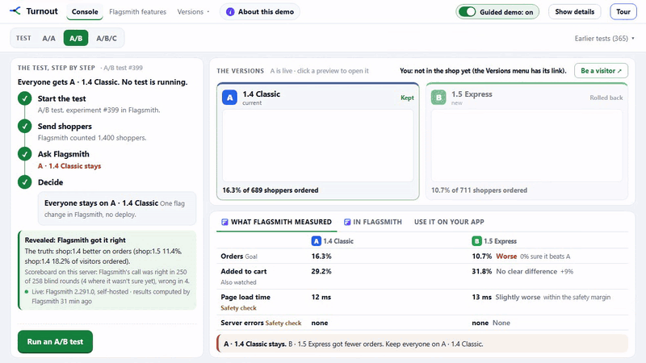

# Turnover

Turnover is a small proxy that sits in front of your web app and turns each new release into a Flagsmith experiment, without any change to the app.

**The question it answers:** can every release be a Flagsmith experiment, and be shipped or reverted on the same flag without leaving anyone behind, with zero changes to the app?

## Try it

You need Docker with Compose 2.20+ and about 8 GB of RAM for Docker. Get the code (`git clone https://github.com/tharunkumardeveloper/turnover-practice.git`, a private practice repo), then:

| | Start (one command) |
|---|---|
| Windows | double-click `turnover.bat` (first time on this machine: `setup.bat` checks and installs what's needed) |
| macOS, Linux | `sh turnover.sh` (first time: `sh setup.sh`) |
| In the browser | [](https://codespaces.new/tharunkumardeveloper/turnover-practice) (needs access to the repo; open the judge link the terminal prints at the end) |

**When it works,** your browser opens judge mode at <http://127.0.0.1:8090/judge> showing **Step 1 of 7**. Follow the steps, or choose **Play it for me**. If anything is missing, <http://127.0.0.1:8090/setup> (or `docker compose run --rm cli doctor`) says what.

## Use it with your app

Step by step, with every flag and what to check: [docs/PLUG_AND_PLAY.md](docs/PLUG_AND_PLAY.md).

The shop is one example. Any web app with two or more releases you can reach over HTTP works: containers, or apps on your machine (`http://host.docker.internal:3000`, on Linux too). In your project's folder:

```sh
# 1. Four questions (Flagsmith: bundled or yours; the releases; success, e.g. "POST /signup 2xx" or "header signup"; % of traffic)
docker run --rm -it -v "$PWD:/work" -w /work ghcr.io/tharunkumardeveloper/turnover new
# 2. Set up Flagsmith: the release flag, metrics, the experiment (yours: add --project <name|id> --environment <name|key>)
docker compose -f turnover.compose.yml run --rm cli init
# 3. Start the proxy (your app on :8080) and the console (:8090)
docker compose -f turnover.compose.yml up -d
```

`new` writes `turnover.config.yml`, `turnover.compose.yml` (the proxy, the console and the CLI, plus your release images if you gave images) and, for a bundled Flagsmith, `flagsmith.compose.yml`. Every answer is also a flag, for scripts: `new --yes --release v1=http://host.docker.internal:3000 --release v2=http://host.docker.internal:3001 --success "POST /signup 2xx" --traffic 50`. With your own Flagsmith, `init --project` reuses your project and environment and creates nothing else; it never touches other flags ([docs/SETUP.md](docs/SETUP.md#bring-your-own-flagsmith)).

> **The image isn't published yet.** `.github/workflows/publish.yml` pushes `ghcr.io/<owner>/turnover` on a version tag, and hasn't run. Until then, build it from this checkout (`docker build -t ghcr.io/tharunkumardeveloper/turnover .`) or run `node src/cli.ts new` here and pass `--image turnover:local`.

A second, different example lives in [`examples/landing/`](examples/landing/README.md): a static landing page with a Sign up button, two releases as two containers, success = `POST /signup` 2xx.

### Will it work with my app?

- **Success is a web request.** For example "`POST /checkout` returned 2xx" or "`GET /thank-you` loaded". A click that only changes the page in the browser can't be measured, unless the app names the event in a response header (below).
- **Both versions work with the same data.** They share the database, so schema changes must stay backward compatible.
- **No hard-coded hostnames.** Use relative links (`/cart`, not `http://app-v2:3000/cart`) so visitors stay behind Turnover. Turnover already rewrites a redirect's `Location` header that points at the release's own address to a relative path; links inside pages, scripts and API responses are not rewritten. If the app must print absolute links, serve its public host name through Turnover so those links come back to the proxy.
- **Give the `https://` URL for a release served over https.** Turnover calls each release at the address you gave it.
- **Test with a browser, not `curl`.** Turnover treats `curl` and other non-browser user agents as bots: they are served but never counted. Use a browser, or send a browser `User-Agent`.
- **Running next to another Turnover?** `turnover new --proxy-port <port> --console-port <port>` publishes the proxy and the console on free ports; `init` prints the judge link with that console port.
- **No cookies named `tv_id` or `tv_preview`.** Those are Turnover's: `tv_id` keeps each visitor on the same version. The proxy removes those two from the request before it reaches your app; your app's own cookies pass through both ways untouched.
- **A visitor counts from their second request.** The first response sets `tv_id`; exposures and events are recorded only once the browser sends it back, so a conversion on the very first request isn't counted.

#### Optional: name the event in a response header (still no SDK)

When success isn't a fixed request, the app can say so itself. Set `header: true` on the goal:

```yaml
goal:
  event: signup
  header: true          # with or instead of `when:`
```

and answer the converting request with `X-Turnover-Event: signup`. Several events are comma-separated, and each may carry a number for sum or mean metrics: `X-Turnover-Event: signup, plan_chosen;value=49`. Turnover sends each as a Flagsmith event for that visitor on the same terms as the `when:` goal (only once the visitor's cookie came back, never for bots or when Flagsmith couldn't answer), ignores invalid names and guardrail names, takes at most 5 per response, and removes the header from every response, with or without `header: true`, so visitors never see it. `init` creates the metric for `goal.event`; other event names reach Flagsmith but need a metric there to be measured. If a request both matches `when:` and names `goal.event`, it counts once. `turnover new --success "header signup"` writes this goal.

## Why it can't make the four wiring mistakes

Hand-wiring an experiment into an app commonly goes wrong in four ways. Turnover's design rules each one out:

| Mistake | Why it can't happen here |
|---|---|
| Unstable identifier | Every visitor gets one random first-party ID cookie, kept for a year, and that ID is the Flagsmith identity ([`src/proxy/server.ts:119-129`](src/proxy/server.ts), [`:202`](src/proxy/server.ts)) |
| Exposures recorded on one side only | The proxy routes the request from the same evaluation that records the exposure, so every arm records them the same way ([`src/proxy/server.ts:141-150`](src/proxy/server.ts)) |
| Exposures rising while conversions stay flat | Conversions come from the real HTTP response (`POST /checkout` returning 2xx) under the same ID ([`src/proxy/server.ts:166-171`](src/proxy/server.ts)) |
| A boolean flag converted to multivariate late | `init` creates the release flag with a release label as its value and adds the `v2` variant in the same run, before any experiment ([`src/commands/init.ts:130-135`](src/commands/init.ts), [`:176-185`](src/commands/init.ts)) |

Decisions read Flagsmith's own credible interval: when it crosses zero, Turnover recommends **Keep running** rather than a ship. `turnover release --aa` runs an A/A test (the same release on both sides), and `turnover check` is an Experiment Doctor for any Flagsmith team, proxy or not.


Turnover runs as an overlay on Flagsmith's official self-hosted Docker Compose. Built for Toggle Wars: The Flagsmith Experimentation Hackathon (Nov 26–29, 2026), Track 03: Build on Open Source Flagsmith. Licence: BSD-3-Clause.

## The problem

1. **A release isn't an experiment.** A Flagsmith experiment is app code: Flagsmith's PayPal-button example has three touchpoints in the app (`useExperiment`, `trackEvent` and an anonymous ID; [`example-paypal-button.md:56,61,76`](https://github.com/Flagsmith/flagsmith/blob/main/docs/docs/experimentation/example-paypal-button.md)). When the change is the whole deploy, v1.4 against v1.5, there's no single line to wrap in a flag.
2. **Ending an experiment has a sharp edge.** The docs say to end the experiment, then update the flag ([`analyse-an-experiment.md:58-61`](https://github.com/Flagsmith/flagsmith/blob/main/docs/docs/experimentation/analyse-an-experiment.md)). On the pinned image, the experiment's split stays in place after it's completed until the flag's next experiment starts, so that edit reaches none of the identities the rollout covered: we measured 144 of 300 still on control. **Ship winner** drains the split first: 300 of 300 on the winner. Details and sources: [docs/FLAGSMITH.md](docs/FLAGSMITH.md#ending-an-experiment-what-the-docs-say-and-what-the-pinned-image-does).

## What Turnover does

| Round | Flagsmith does | Turnover does |
|---|---|---|
| 01 Multivariate flag | `shop_release` has variants `control` and `v2`; each variant's **value** is the release it serves (`shop:1.5`) | Routes each visitor to the container for that release, from an allowlist |
| 02 Metrics | Holds the goal and the guardrails | Turns HTTP into events: "POST /checkout returned 2xx" becomes `order_placed` (the goal), "POST /cart/add" becomes `add_to_cart` (a secondary funnel metric, never a guardrail); every page load gives `doc_latency_ms` and `server_error` |
| 03 Split traffic | Buckets visitors, records exposures, computes the Bayesian result | Records an exposure when a returning visitor loads a page |
| 04 Ship the winner | Serves the winner from the same flag | Warns when the winner is losing a guardrail; ships in an order that reaches everyone; writes the decision to the release |

**The demo, in order** (simulated visitors, labelled as such):
1. `shop:1.5` (one-page checkout: cart, shipping and payment on one page) against `shop:1.4` ("Step 1 of 3" checkout). Simulated visitors add to cart at the same rate on both; 1.5 wins at checkout completion, so `add_to_cart` stays level while `order_placed` rises. Preview browsers and debug requests see a "Release 1.5" footer badge (the proxy sends the app an `X-Turnover-Release` request header for them only, and strips any copy a visitor sends); ordinary visitors never see it. `grep -ri flagsmith` over the shop image finds nothing, yet Flagsmith's results page shows v2 ahead. **Ship winner**: the traffic map's two tracks merge.
2. One edit to the flag's default swings everyone back, made in Flagsmith's flag editor or with the console's **Swing back** button; the console notices that the flag changed after the ship.
3. `turnover preview shop:1.6`: only your team's browsers see it. `turnover release shop:1.6` starts the next experiment on the same flag.
4. `shop:1.6` carries a **deliberate test fault**: a labelled 60 ms delay on every page (`SEEDED_DELAY_MS`), there to show a guardrail catching a release that wins on orders. It wins on orders, but Flagsmith shows it losing on `doc_latency_ms`; the Ship dialog says so in red and asks you to accept that. You **Revert** instead, and the release notes record why.



## How it works

```text
             ┌──────────────────────── Turnover ────────────────────────┐
 visitor ───▶│ cookie identity → Flagsmith flag (local evaluation)        │───▶ shop:1.5  (control: live release)
             │ HTTP rules → exposures, conversions, guardrail events      │───▶ shop:1.6  (v2: new release)
             └────────────────────────────┬───────────────────────────────┘
                                          │ events (server key)
                                          ▼
                               self-hosted Flagsmith
                      flag · rollout · metrics · Bayesian results
```

1. **Identity and routing.** One random first-party ID cookie per visitor (no names, emails or IPs). The Node SDK evaluates the flag locally, so routing adds no network call. The flag's value names a release; only releases in `turnover.config.yml` are reachable.
2. **When Flagsmith can't answer** (not loaded yet, slower than 150 ms, flag off, a value not in the allowlist) a visitor gets the **live release**: what visitors outside the experiment are served, remembered across restarts. Bots get it too, and are never counted.
3. **Events.** Only visitors who sent the cookie back are counted, so one-request clients never become identities. A page load records the exposure; rules turn responses into conversions; page loads send the guardrails. All server-side; no client key is published.
4. **Scoring.** Flagsmith alone computes lift, credible interval and chance to win. Turnover shows its numbers as returned.

The whole integration is one file, [`turnover.config.yml`](turnover.config.yml): the flag, the allowlist of releases and their containers, the goal as an HTTP rule (`POST /checkout` returning 2xx) and the guardrails.

### Ship winner and Revert

The winner is pre-selected by the results page's own rule ([how Turnover reads it](docs/FLAGSMITH.md#the-results-pages-winner-as-turnover-reads-it)) and confirmed by a person. If Flagsmith shows it losing a guardrail (under 5% chance to win), the console and CLI say so in red and need an explicit "ship anyway".

| Step | What Turnover does | Why |
|---|---|---|
| 1 | Pause the experiment | No new exposures while traffic moves |
| 2 | Save a decision snapshot of Flagsmith's results | The evidence, kept before anything moves; its path goes into the release notes |
| 3 | Set the flag's environment default to the winner, enabled | Everyone outside the experiment gets the winner; the default keeps the value control served, so control stays the same release |
| 4 | Set the rollout to 0%, with the winner's weights | Drains the experiment's cohort onto the default |
| 5 | Complete the experiment | Results are final; the flag is an ordinary flag again |

Each step shows its API call first, is read back from Flagsmith afterwards (the sequence stops if the change doesn't show), is safe to re-run, and is recorded in Turnover's release ledger. **Revert** is the same sequence with control as the winner, so it leaves no split behind either. Rolling back after a ship is an ordinary flag edit.

### Guarded releases, shown in Flagsmith's own dashboard

While an experiment runs, the console reports the release flag's health to **Flagsmith's Feature Health** (its generic Webhook provider, which `init` sets up). When the new release loses a guardrail, Flagsmith tags the flag **Unhealthy** in its own dashboard, with Flagsmith's numbers as the reason, for example "83 on shop:1.6 vs 15 on control; chance to win 0.0%" (means per exposed identity; an identity with no event counts as 0). The tag clears when the experiment ends.

**The guard** is opt-in (`TURNOVER_GUARD=revert`, or the switch in judge mode). It asks Flagsmith for fresh results every 5 minutes, Flagsmith's own limit, and reverts when a guardrail's chance to win drops to 1% or below with at least 100 identities. **It never ships on its own.** The ledger says who decided: "Reverted to control (shop:1.5) automatically by Turnover's guard".


### Releases on one flag

| Stage | Command | Flagsmith feature |
|---|---|---|
| **Preview** | `turnover preview shop:1.6` | A segment override (`turnover-preview`: trait `preview = true`) serves the new release to browsers that opened the preview link. It ranks above the experiment's rollout, so your team stays out of the experiment's data |
| **Experiment** | `turnover release shop:1.6 --hypothesis "…"` | What the flag serves today becomes `control`, the new release `v2`; the next experiment starts with the hypothesis in Flagsmith's required field |
| **Decision** | Ship winner or Revert | The environment default, as above |

**The release ledger.** Each decision is appended to `.turnover/ledger.jsonl` and rendered into `.turnover/RELEASES.md`: the experiment, the hypothesis, Flagsmith's results as returned, the decision, any guardrail you accepted and the decision snapshot's path. With `GITHUB_TOKEN` and `GITHUB_REPOSITORY` set, the same section goes into the GitHub Release for the release's tag (`shop:1.6` → `v1.6`). Flagsmith also writes each change to its audit log, but a free self-hosted plan shows 0 days of it, so the ledger is the record you can read.


## Running it by hand

The start script also takes `demo`, `status`, `stop` and `reset` (`reset --yes`, or `reset /yes` on Windows, wipes without asking). Plain `docker compose` works in any shell too:

```bash
cp .env.example .env
docker compose up -d --wait flagsmith   # Flagsmith on 127.0.0.1:8000, once healthy
docker compose run --rm cli init        # bootstraps Flagsmith, writes keys to .env
docker compose up -d --build            # proxy :8080, console :8090, three shop releases
docker compose run --rm cli doctor      # is everything in place?
```

Links use `127.0.0.1` rather than `localhost`: on Windows, a browser that tries `localhost`'s IPv6 address first waits for that attempt to fail. In Codespaces, [`.devcontainer/start.sh`](.devcontainer/start.sh) runs these steps and adds the forwarded `*.app.github.dev` hostnames to `.env`. More in [docs/SETUP.md](docs/SETUP.md): what the scripts check and install, judge mode on a phone or another computer, Linux user ids, ports and networks, and using an existing Flagsmith instance.

## Judge mode

<http://127.0.0.1:8090/judge> runs the whole story from a browser. A welcome screen offers **Guide me** (you click, the tour shows where) or **Play it for me** (an on-screen cursor clicks). Each tour beat first moves a spotlight to one thing on the page, then explains it. The page is a three-column dashboard: the seven demo steps and the release history; the flow line, live numbers and track map with the one thing to do now; and **In Flagsmith right now**, read from Flagsmith's API. Flagsmith's dashboard refuses to be framed, so "see it in Flagsmith" opens it in one separate browser tab. There are two tours. The **Quick tour** (the default, about 2.6 minutes played for you) runs one release through visitors, results and Ship, then sums up the guardrail story in one beat, with the option to play round two. The **Full tour** (about 9 to 10 minutes) runs both releases, including the guardrail revert, the feature map and the setup check. Flagsmith's sign-in details appear only when you open a Flagsmith link, not as a step of their own.

Each shop release has its own look, so you can tell at a glance which one served you: 1.4 **Classic** (blue, multi-step checkout), 1.5 **Express** (green, one-page checkout) and 1.6 **Bold** (charcoal and orange, with the deliberate 60 ms test fault that trips the page-speed guardrail). After a ship, judge mode also offers an optional swing back; the full console at <http://127.0.0.1:8090/> adds a choice of how many visitors to send. Details: [docs/JUDGE_MODE.md](docs/JUDGE_MODE.md).


## `check` and `ship` on any Flagsmith experiment

These work without the proxy, on experiments your app runs through the SDK. `check` is read-only: it reads the environment document and exits 1 when an experiment's split is still on a flag whose experiment isn't running. With only a server key it can't tell a paused experiment from a completed one, so both fail; with an admin key it reads each experiment's status. It is also a **reusable GitHub Action** (`action.yml`):

```yaml
- uses: actions/checkout@v5
- uses: <owner>/<repo>@<ref>   # this repository
  with:
    api-url: https://flagsmith.example.com/api/v1/
    server-key: ${{ secrets.FLAGSMITH_SERVER_KEY }}
    admin-key: ${{ secrets.FLAGSMITH_ADMIN_KEY }}   # optional: tells paused experiments from completed ones; submits Code References
    project-id: 1                                     # with admin-key
```

`ship "<experiment link>"` takes the link Flagsmith's experiment page ends on (`…/environment/<key>/experiments/<id>`), prints the results and the plan, and waits for you. Every command and option: [docs/CLI.md](docs/CLI.md).

## Security model

- **Keys are split by container.** The public proxy gets only the server key and the preview token. The admin key lives in the console and the one-off CLI. The console also holds Flagsmith's admin login for judge mode's sign-in step, which shows the password only on this machine.
- **Networks are split too.** The proxy shares a network with Flagsmith's API (flag reads and events), one with the console (the traffic feed) and one with the shops, but can't reach Postgres or the console's admin traffic. The shops reach only the proxy.
- **The proxy can only reach allowlisted releases.** It accepts only `/path` request targets (`//host/…`, absolute URLs and backslashes get a 400), builds every upstream URL from the allowlist, and answers WebSocket upgrades with a 501.
- **The console** is published on `127.0.0.1:8090` only, accepts only loopback Host headers (against DNS rebinding), needs a per-boot token on every API call, and refuses an action if the experiment changed since the page loaded. Other devices use a second port, `8091`, where every request needs the judge cookie whatever Host header it sends, and the admin password is never sent. The judge link that sets the cookie carries `TURNOVER_JUDGE_TOKEN`; rotate the token to revoke it.
- **Flagsmith's own port** stays on `127.0.0.1` even when Turnover's are published to your network: the official compose file's placeholder secrets are kept.
- **The preview cookie** holds an HMAC of the preview token, not the token. Rotate `TURNOVER_PREVIEW_TOKEN` to revoke every preview browser.
- **Responses are per visitor**, so Turnover sets `Cache-Control: private` and `Vary: Cookie`, and strips its own cookies before anything reaches the app.

## Evidence

All on Flagsmith `2.291.0` and Node SDK `9.4.0`, Docker Desktop on Windows 11 unless noted. Raw logs in [`spikes/RESULTS.md`](spikes/RESULTS.md).

| What | Result |
|---|---|
| Ending an experiment the documented way, 300 identities | 144 stayed on control (the split survives); after Ship winner, 300 of 300 on the winner; one default edit back, 300 of 300 on control |
| The full cycle on a fresh instance: init → 2,000 visitors → Ship → swing back → preview → release → 2,000 visitors → Revert | Flagsmith's identity counts equal the simulator's visitor counts (1,000 / 1,000 per arm); its own counter: 17,910 events accepted, 0 rejected |
| shop:1.6, deliberate test fault (60 ms delay) | Orders: 99.8% chance to win. `doc_latency_ms`: 97.6 vs 26.5 ms (means per exposed identity), 0.0% chance to win. Ship refused without explicit acceptance; Revert left 200 of 200 new visitors on shop:1.5 and `check` clean |
| First start from a fresh `.env`, Docker images already downloaded | Windows (`turnover.bat`): 135 s; Linux userland as uid 1234 (`turnover.sh`, Alpine): 128 s. Doctor: 29 ok, 0 warnings, 0 failing |
| `reset --yes` (wipe and start again) | Windows: 142 s, then experiment 1 running again with an empty ledger; Linux: 135 s. Doctor: 29 ok after each |
| Ship click → every new visitor on the winner (n = 1) | 7.05 s; the five steps took 7.1 s |
| Swing back or forward (one default edit through the API, n = 14) | Click → every new visitor on the new release: median 1.58 s, range 1.08–6.07 s. The first 8 runs were evenly spaced and kept the same phase against the SDK's 5 s refresh; the 6 started at random times took 0.78–4.17 s from flag saved to routed, median 2.48 s |
| The same edit in Flagsmith's own flag editor (n = 7) | Click → every new visitor on the new release: median 3.25 s, range 1.50–9.68 s |
| Feature Health and the guard | Flagsmith tagged `shop_release` "Unhealthy" within 20 s, with Turnover's reason and links; the guard, once switched on, reverted the experiment and the tag cleared; 30 of 30 new visitors on shop:1.5 |
| Preview | A preview browser kept shop:1.6 through the experiment, `enrolled: false`, out of the data |
| Open-proxy attempts (`//flagsmith:8000/…`, `//console:8090/…`, absolute-form, `/\host`) | 400, and the proxy keeps serving; covered by tests |

Seen in testing (shop:1.5 is about 0.7 ms slower than shop:1.4): the first experiment's latency guardrail read as losing in 2 of the 5 runs on record as of 18 Nov 2026, so Ship asked for that loss to be accepted. Losing: a fresh Windows stack (1,500 visitors, 3.0% chance to win) and experiment 23 (18,000 visitors, 2.6%). Inconclusive: the Linux run (21.5%). Not losing: the timed tour. Not recorded: the experiment 22 timing runs.


**Not claimed:** production users, prevented incidents, or any simulated or seeded number as evidence about real users.

## How Flagsmith is used

Without Flagsmith, Turnover can't route, enrol, measure, score, ship or keep its release history. It uses a multivariate flag whose variant values are release labels; experiments, their rollout and lifecycle API; local evaluation with `getExperimentFlag` and `trackEvent`; the events endpoint's per-event answers; metrics with directions; the Bayesian results and the results page's winner rule; the environment document; segments and override priority; Feature Health; a permanent tag, which puts the flag under the **Permanent** lifecycle stage; **Code References** (`init`, `turnover code-refs` and the Action submit where the flag's name appears; in this repository that is only `turnover.config.yml`, never the app); Flag Analytics; Prometheus metrics; the sign-up and Admin APIs; and the official Docker Compose. Each one, with file and line: [docs/FLAGSMITH.md](docs/FLAGSMITH.md). The console's `/flagsmith` page lists every Flagsmith menu and integration with what Turnover does with it.


## Prior art

| Tool | How Turnover differs |
|---|---|
| LaunchDarkly Guarded Rollouts (Enterprise add-on) | Open source on self-hosted Flagsmith; Flagsmith's Bayesian result; the guard reverts automatically but never ships; the health shows on the flag in Flagsmith; the result lands in the release |
| GrowthBook URL Redirects; VWO and Optimizely split-URL tests | No redirect and no snippet; Flagsmith's flag, metrics and engine |
| Vercel Rolling Releases, Netlify Split Testing | Any host you run; a product goal and guardrails scored by Flagsmith |
| Flagger, Argo Rollouts, Kayenta | No Kubernetes or Spinnaker; product metrics, not only ops metrics; shipped on one flag |
| SiteSpect (commercial tagless A/B proxy) | BSD-3; router, metrics, result and ship are one Flagsmith flag |

Turnover never redirects: Flagsmith's docs list "redirects that bypass bucketing" among causes of sample-ratio mismatch (`statistics.md:107`).


## Limitations

- **Both versions share state**, as in blue/green: schemas must stay backward compatible.
- **Page-level only.** SPA navigations aren't new exposures; conversions must be visible in HTTP (a request, or an `X-Turnover-Event` response header). A visitor counts from their second request (the first one sets the cookie).
- **One experiment per flag per environment** (Flagsmith's rule): releases run one at a time.
- **A new hop in the traffic path.** Teams will want to put the proxy through their own security review.
- **The ID cookie** is an online identifier; in the EU a cookie notice or consent may apply.
- **Routing follows a flag change** after Flagsmith's document rebuild plus up to the SDK's 5-second refresh.
- **`ship` is refused** where change requests are enabled (`features/future/views.py:31-44`).
- **Built on a beta.** Image and SDK versions are pinned; Flagsmith's own event store is for evaluation, not production volumes.
- **Not built:** statistics of its own, automatic shipping (the guard only reverts), WebSocket routing, a per-visitor opt-out, experiment audiences on traits other than `preview` (the proxy sends no other traits; `doctor` warns).
- **The guard acts on Flagsmith's results**, which refresh at most every 5 minutes; harm can run that long before a revert.
- **Flagsmith features not used**, each with its reason, are listed on the console's `/flagsmith` page and in [docs/FLAGSMITH.md](docs/FLAGSMITH.md); for example, Flagsmith's outgoing webhooks refuse private addresses, so they can't call a console on the Compose network.

## Development

`npm test` runs the unit and integration tests (Node's built-in runner; no build step, since Node 24 runs the TypeScript directly). `npx tsc --noEmit` typechecks. Layout, commands and conventions: [docs/DEVELOPMENT.md](docs/DEVELOPMENT.md).

## License

BSD-3-Clause, matching Flagsmith.
