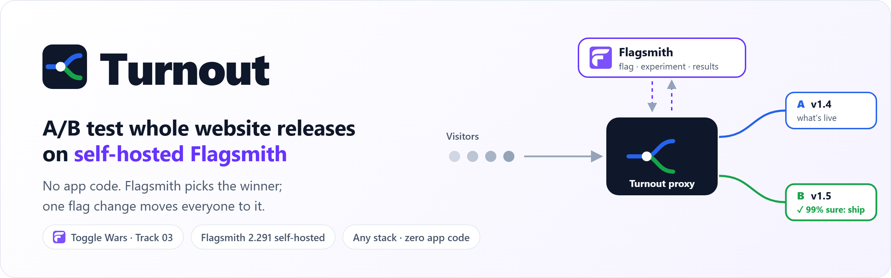
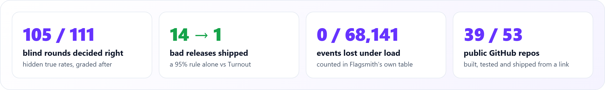
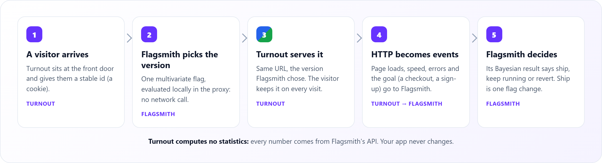

<div align="center">

<picture>
  <source media="(prefers-color-scheme: dark)" srcset="docs/images/readme/header-dark.png">
  
</picture>

[**▶ Demo video (2:50)**](https://www.youtube.com/watch?v=uoJtfs4HVrE) · [**Live demo**](https://172-198-62-67.sslip.io) · [Get started](#get-started) · [Features](#features) · [How Flagsmith is used](#how-flagsmith-is-used) · [Proof](#proof)

[](https://codespaces.new/tharunkumardeveloper/turnout?quickstart=1)
[](https://github.com/tharunkumardeveloper/turnout/actions/workflows/ci.yml)
[](LICENSE)

</div>

A Flagsmith experiment normally lives in your app's code: `getExperimentFlag` and `trackEvent` at every touchpoint. That works for one button, not for *"is our redesign, or release 1.5, better than what's live?"* **Turnout puts the experiment at the front door instead:** two versions of your site behind one URL, a Flagsmith flag routing each visitor, plain HTTP turned into Flagsmith events, and Flagsmith Experimentation deciding the winner. Ship or Revert is one flag change. Your app never changes, in any language.

<picture>
  <source media="(prefers-color-scheme: dark)" srcset="docs/images/readme/numbers-dark.png">
  
</picture>

## Get started

**1. Docker.** [Docker Desktop](https://www.docker.com/products/docker-desktop/) (Windows, macOS) or Docker Engine (Linux), running, with about 4 GB of memory for it.

**2. Install, one line.** It downloads the tagged release and adds the `turnout` command:

```powershell
# Windows (PowerShell)
irm https://raw.githubusercontent.com/tharunkumardeveloper/turnout/main/install.ps1 | iex
```
```sh
# macOS, Linux
curl -fsSL https://raw.githubusercontent.com/tharunkumardeveloper/turnout/main/install.sh | sh
```

**3. Run it.**

```sh
turnout demo                                    # the demo shop and guided demo, at 127.0.0.1:8090
turnout compare localhost:3001 localhost:3002   # or your own two versions
```

`demo` starts self-hosted Flagsmith, creates the flag, metrics and experiment, starts the proxy and opens the console (about 2 minutes the first time). In the console, turn on **Guided demo** and press the green button in each step: Start, Send shoppers, Ask Flagsmith, Ship. `turnout uninstall` removes everything it set up.

<sub>Nothing to install: the [live demo](https://172-198-62-67.sslip.io), or [Codespaces](https://codespaces.new/tharunkumardeveloper/turnout?quickstart=1) (a 4-core codespace runs the same demo). Rather clone than pipe a script? See [Step by step](#step-by-step).</sub>

### Live demo or your machine?

The [live demo](https://172-198-62-67.sslip.io) shows the whole loop in a minute with nothing installed. **For the full feature set, run it locally:** a shared public server can't run strangers' code or hand out Flagsmith's admin login.

| | Live demo | Your machine |
|---|:---:|:---:|
| Guided A/A, A/B and A/B/C tests, Flagsmith's results, Ship and Revert | ✅ | ✅ |
| Blind rounds (hidden true rates, scored after) and the live traffic map | ✅ | ✅ |
| *Be a visitor*: get a version from Flagsmith yourself | ✅ | ✅ |
| Every Flagsmith feature Turnout uses, with live values | ✅ read-only | ✅ with links into Flagsmith |
| Flagsmith's own dashboard, with Turnout's tour inside it | — admin login stays private | ✅ |
| **Try it with your app**: paste GitHub links, no Dockerfile needed | — it builds and runs code | ✅ |
| `turnout compare` on your own site, `browsers`, `simulate`, the setup check | — | ✅ |
| Preview for your team, Pin my browser, the Feature Health guard | — | ✅ |

## See it

<table>
<tr>
<td width="50%" valign="top"><br><b>The guided demo.</b> Start, shoppers, Flagsmith's call, decide. Blind rounds hide the true rates until the end.</td>
<td width="50%" valign="top"><br><b>Your app from a GitHub link.</b> Two links, no Dockerfile: Turnout builds them and starts the A/B test.</td>
</tr>
<tr>
<td width="50%" valign="top"><br><b>Every visitor, live.</b> The flag's weights pick each request's track; one flag change moves the stream.</td>
<td width="50%" valign="top"><br><b>Inside Flagsmith.</b> Everything Turnout does is a real Flagsmith object; its tour walks through them.</td>
</tr>
</table>

## How it works

<picture>
  <source media="(prefers-color-scheme: dark)" srcset="docs/images/readme/how-dark.png">
  
</picture>

The same experiment written with the SDK inside the demo shop took **45 lines of app code and hit two silent traps** ([with vs without](examples/with-sdk/README.md)); with Turnout the shop has 0 lines and the config 12. Unlike canary tools (Argo Rollouts, Flagger), which judge a release on errors, Turnout asks the product question, *does it get more sign-ups?*, and keeps errors and speed as safety checks. More: [How it works](docs/HOW_IT_WORKS.md).

## Features

| | |
|---|---|
| **Run a test** | `turnout compare` on URLs, Docker images or git branches, any number of versions (`--goal`, `--split`, `--env-file`); `turnout demo`; **Try it with your app** from GitHub links, folders or images, no Dockerfile needed |
| **Measure** | One visitor id per browser, bots never counted; the goal from any HTTP request or an `X-Turnout-Event` header; server response time and errors; page speed in visitors' browsers (`--browser-speed`: largest paint, layout shift), compared only when both versions reported; `turnout browsers` for real headless-Chrome visits; `turnout simulate` for labelled pretend shoppers |
| **Decide** | Flagsmith's Bayesian results as returned. Ship only when Flagsmith is 95% sure, its interval clears zero and every safety check passes; otherwise *keep running*, with the visitors it would take to settle; A/A tests; the Experiment Doctor with a sample-ratio check |
| **Release** | Ship and Revert in one flag change that also drains the split; a preview segment for your team; *Pin my browser* (identity override); Feature Health marks a loser Unhealthy, and an opt-in guard reverts it; a release ledger and GitHub Releases |
| **Console** | Live traffic map, guided demo with tours, results table, a setup check with 28 checks, a map of every Flagsmith feature with live values, and a tour inside Flagsmith's dashboard |
| **Automate** | `turnout check` as a GitHub Action (job summary and one pull-request comment); an [agent skill](skills/turnout-experiment/SKILL.md) that stops for a person to ship; server mode with HTTPS, an autopilot and blind rounds; `turnout deploy` prints your nginx or Caddy lines |
| **Install** | One-line installers for Windows, macOS and Linux; Codespaces; a public image on GitHub Container Registry; `turnout uninstall` |

Every feature, one line each: [FEATURES.md](FEATURES.md). Every command: [docs/CLI.md](docs/CLI.md).

## How Flagsmith is used

Self-hosted Flagsmith 2.291.0 from its official Docker Compose file ([compose.flagsmith.yml](compose.flagsmith.yml)), Experimentation on, its event store on PostgreSQL. **Turnout computes no statistics:** every number on its pages comes from Flagsmith's API.

| Flagsmith | In Turnout |
|---|---|
| **Multivariate flag**, local evaluation | One flag per app; each variant's value names a version. The proxy evaluates it in-process, with no network call per request. |
| **Metrics and events**, event store | Plain HTTP becomes events: the goal, add to cart, server response time and errors, and browser page speed. |
| **Experiments**, Bayesian results | A/A, A/B and A/B/C tests. Chance to be best, credible interval and lift decide Ship, Keep running or Revert. |
| **Environment default**, rollout | Ship and Revert set the default and drain the split: everyone moves at once, no redeploy. |
| **Segments**, **identity overrides** | A preview for your team; a pinned browser. Both stay out of the test. |
| **Feature Health**, tags, Code References, Admin API | A losing safety check shows Unhealthy in Flagsmith; a permanent `release` tag; the flag's code references; everything created automatically. |

Every Flagsmith fact with its source file and line: [docs/FLAGSMITH.md](docs/FLAGSMITH.md).

## Proof

**A real release, measured.** Gitea 28.0.0's release notes promise a faster repo page. Turnout ran 1.27.3 and 28.0.0 side by side with 940 real headless-Chrome visits and let Flagsmith decide: the server answers **13.8% faster** (100% sure), but the page's main content appears **no sooner** (+5.5%, interval −3% to +14%). [Method and raw numbers](docs/FINDING_GITEA.md).

**Flagsmith's calls, graded.** In 111 blind rounds on the live demo (true rates drawn at random and hidden), Flagsmith called 36 of 38 real differences, never in the wrong direction, and made 2 false calls in 28 rounds with no difference. Shipping whenever it was 95% sure would have shipped 14 bad releases; Turnout's interval and page-speed checks shipped 1. [The write-up](docs/BLIND_ROUNDS.md).

| Test | Result |
|---|---|
| Shipping under live traffic | a new visitor every 0.1 s: after Ship, 514 of 514 on the winner |
| Under load | 0 of 68,141 events lost, up to 200 visitors at once, counted in Flagsmith's own table |
| Flagsmith down | 100 of 100 pages still served (173 ms average, 170 ms with it up) |
| Any app | 12 sample apps (HTML, Vite, Next.js, Express, Flask, Django, Go, PHP…): 12 of 12 ship ([scoreboard](scoreboard/README.md)) |
| Real GitHub repos, pasted as links | 39 of 53 build, run, get Flagsmith results and ship; each failure's reason in [github-run.json](scoreboard/github-run.json) |
| A server, rebooted | every container back by itself, every check passing |

All measured during Toggle Wars; raw logs in [spikes/RESULTS.md](spikes/RESULTS.md). The demo's shoppers are simulated and labelled; real visitors on the live shop count in a separate experiment. Tried it? [Tell us how it went](https://github.com/tharunkumardeveloper/turnout/issues/new?template=tried-turnout.yml).

### Built on Flagsmith, given back to Flagsmith

| I hit | Turnout | Upstream |
|---|---|---|
| On 2.291.0, ending an experiment left 150 of 300 visitors on the old split (2.295.2 had already fixed it) | Ship drains the split: 300 of 300 on the winner | [Flagsmith#9120](https://github.com/Flagsmith/flagsmith/issues/9120); Flagsmith rewrote its docs in [#9141](https://github.com/Flagsmith/flagsmith/pull/9141) |
| The Node SDK dropped 28% of events tracked faster than one batch round-trip | Holds events back while the buffer is full: 0 lost | [#330](https://github.com/Flagsmith/flagsmith-nodejs-client/issues/330), fix [PR #331](https://github.com/Flagsmith/flagsmith-nodejs-client/pull/331) |
| Pointed at a self-hosted Flagsmith, the SDK still sent events to Flagsmith Cloud | Sets the events address to your instance | [#332](https://github.com/Flagsmith/flagsmith-nodejs-client/issues/332) |
| Results recompute at most every 5 minutes | Asks only once visitors' events are in | |

## Step by step

<details>
<summary><b>Install from a clone instead</b> (or check your machine first)</summary>

```sh
git clone https://github.com/tharunkumardeveloper/turnout.git turnout
sh turnout/install.sh                                         # macOS, Linux
powershell -ExecutionPolicy Bypass -File turnout\install.ps1  # Windows
```

Open a new terminal, then `turnout help`. Not sure your machine is ready? `sh turnout/setup.sh` (macOS, Linux) or `turnout\setup.bat` (Windows) checks Docker, Compose, memory and ports. On Linux your user must be able to run `docker`.
</details>

<details>
<summary><b>The demo, step by step</b></summary>

`turnout demo` opens <http://127.0.0.1:8090>. With **Guided demo** on:

1. Pick **A/A**, **A/B** or **A/B/C**. A preview of the versions shows first.
2. Press the green button in each step: **Start**, **Send shoppers**, **Ask Flagsmith**, then **Ship** or **Roll back**.
3. The **In Flagsmith** tab shows the flag, the split and the login for Flagsmith's dashboard at <http://127.0.0.1:8001>, where **✦ Turnout tour** walks through it.
4. **Be a visitor** gets you a version; **Pin my browser** always gives you one.

`turnout demo stop` stops it; `turnout demo reset` starts over. In a terminal only: [docs/TERMINAL.md](docs/TERMINAL.md). Everything to check: [docs/TESTING.md](docs/TESTING.md).
</details>

<details>
<summary><b>Test your own app</b></summary>

From your project's folder; the first version is **A**, what everyone gets today:

| You have | Run |
|---|---|
| Two versions running | `turnout compare localhost:3001 localhost:3002` |
| Two Docker images | `turnout compare myapp:1.0 myapp:1.1 --port 3000` |
| Three versions (A/B/C) | `turnout compare myapp:1.0 myapp:1.1 myapp:1.2 --port 3000` |
| Two git branches with Dockerfiles | `turnout compare main new-checkout` |

- `--goal "POST /signup"`: the request that counts as success (a 2xx or 303). No goal: judged on page speed. The console lists the requests it sees, with the exact `--goal` for each.
- `--split 10`: 10% get each new version. `--env-file .env.turnout`: your app's settings. `--browser-speed`: page speed from visitors' browsers.

The console opens at <http://127.0.0.1:8090>: run a test, open your site as a visitor (each new browser is a new visitor), decide. `turnout status` checks everything; `turnout down` stops, keeping data; `turnout reset` wipes.
</details>

<details>
<summary><b>Try it with your app, from the console</b> (local only)</summary>

Press **Try it with your app** and give one, two or three versions: a **GitHub link**, your **project folder**, a **Docker image** or a saved image file. A Dockerfile is optional; Turnout writes one for Node, Python, Go, PHP, Ruby, Java and static sites. It builds them, runs them behind its own proxy and flag (`tryit_release`), and opens your app's console at <http://127.0.0.1:8090/app>. It runs code over the Docker socket, so paste only repositories you would run yourself ([what it can do](docs/HOW_IT_WORKS.md#try-it-with-your-app-what-it-can-do-on-your-machine)), and it never runs on a public server.
</details>

<details>
<summary><b>No visitors yet?</b></summary>

- `turnout browsers --visits 200`: real headless-Chrome visits, labelled automated, so Flagsmith compares page speed in minutes.
- `turnout simulate --visitors 500`: pretend shoppers who browse, follow links and fill in your goal's form at a hidden rate per version, revealed at the end.

Both go to a separate Flagsmith environment, *Demo (simulated)*, never your real experiment.
</details>

<details>
<summary><b>Go live</b></summary>

Run `turnout compare` on the server that takes the traffic, then `turnout deploy your-domain.com` for your web server's lines (nginx `proxy_pass http://127.0.0.1:8080;`, or Caddy `reverse_proxy 127.0.0.1:8080`). Visitors keep your domain; the console stays private (open it over `ssh -L`). The live demo runs this way: [docs/JUDGE_MODE.md](docs/JUDGE_MODE.md).
</details>

<details>
<summary><b>Troubleshooting and good to know</b></summary>

- **Docker isn't running:** start Docker Desktop and wait for *Engine running*. **Out of memory:** give Docker 4 GB.
- **A port is busy:** Turnout picks the next free one and says so.
- **A version doesn't answer:** its last log lines are printed; pass its settings with `--env-file`.
- **Anything else:** `turnout status`, or <http://127.0.0.1:8090/setup> (28 checks).
- **Real results take real visitors:** a few hundred per version. Both versions share your database, as in blue/green. A single-page app's in-browser navigations aren't new visits: put the goal on an API call. One experiment per flag at a time (Flagsmith's rule). A first-party id cookie may need a cookie notice in the EU.
</details>

## Tech stack

<picture>
  <source media="(prefers-color-scheme: dark)" srcset="docs/images/readme/stack-dark.png">
  
</picture>

Node.js 24 running TypeScript directly (no build step) with two runtime dependencies (`@flagsmith/nodejs`, `yaml`); a console in plain HTML, CSS and JavaScript modules; Flagsmith 2.291 and its PostgreSQL event store in Docker Compose; Caddy for HTTPS on the Azure VM that hosts the live demo; GitHub Actions for CI and the reusable Action.

## Development

`npm test` runs 700 tests on Node's built-in runner; `npx tsc --noEmit` typechecks; CI also runs the full server stack. Layout and conventions: [docs/DEVELOPMENT.md](docs/DEVELOPMENT.md).

**How it was built:** much of the code, the tests and the documentation was written with Claude Code (Anthropic's coding assistant), working from my design and direction; commits it co-wrote carry a `Co-Authored-By: Claude` line. I reviewed what it wrote and can explain every part.

## License

[BSD-3-Clause](LICENSE), matching Flagsmith.
