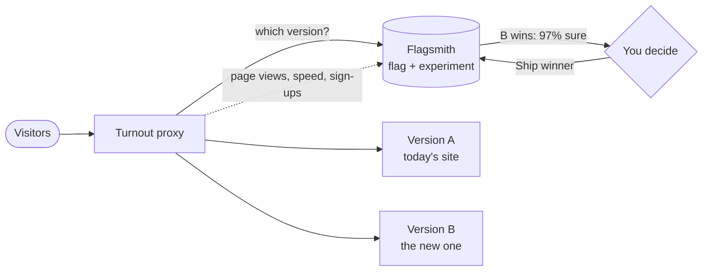
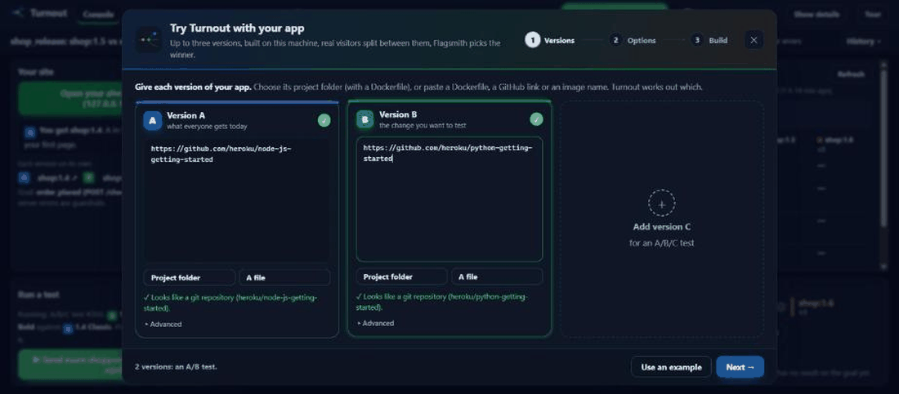
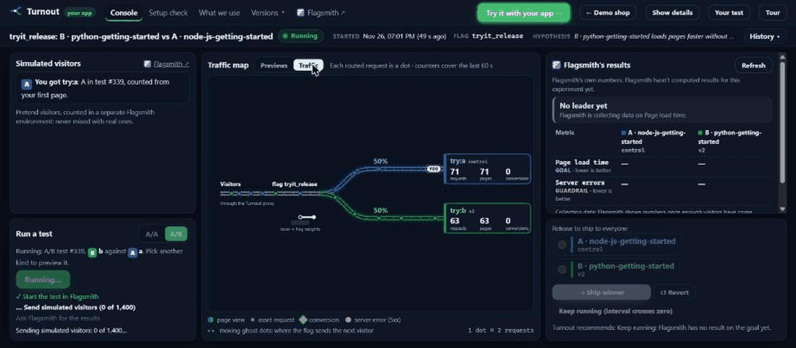

<div align="center">


# Turnout

**Flagsmith Experimentation for whole releases: test a new version of your website on real visitors, let Flagsmith pick the winner, move everyone to it with one click.<br>No changes to your app's code. Built on self-hosted Flagsmith.**

*Toggle Wars entry, Track 03: self-hosted Flagsmith, integrations and developer tools. Every experiment, metric, result and rollout here is Flagsmith Experimentation's own: Turnout computes no statistics.*

[](https://github.com/Flagsmith/flagsmith)
[](https://nodejs.org)
[](https://www.typescriptlang.org)
[](https://docs.docker.com/compose/)
[](https://www.postgresql.org)
[](#development)
[](LICENSE)

[](https://codespaces.new/tharunkumardeveloper/turnout?quickstart=1)

[**▶ Demo video (2:50)**](https://www.youtube.com/watch?v=uoJtfs4HVrE) · [**Live demo**](https://172-198-62-67.sslip.io) · [Quick start](#quick-start) · [Step-by-step setup](#step-by-step-setup) · [How Flagsmith is used](#how-flagsmith-is-used)


</div>

## Track 03 at a glance

| Track 03 asks for | Turnout's evidence |
|---|---|
| **Self-hosted Flagsmith** | Flagsmith's official Docker Compose file, version pinned to 2.291.0 ([compose.flagsmith.yml](compose.flagsmith.yml)), with Experimentation and its event store on PostgreSQL; the [live demo](https://172-198-62-67.sslip.io) runs it on a VM |
| **Integrations and plugins** | A Feature Health provider (Flagsmith marks a losing version Unhealthy), Code References for the flag, a reusable GitHub Action ([action.yml](action.yml)) that writes its result to the job summary and one pull-request comment, and a tour inside Flagsmith's own dashboard |
| **Developer tools** | The `turnout` CLI (`compare`, `results`, `ship`, `revert`, `simulate`), a setup check with 28 checks, the Experiment Doctor (exposures and events on every arm, and a **sample-ratio check (SRM)** against the configured split), Try it with your app (paste a GitHub link), and an [agent skill](skills/turnout-experiment/SKILL.md) that runs a test and stops for a person to ship |
| **Easy for others to reuse** | One-line installers for Windows, macOS and Linux, a public image on GitHub Container Registry, and 53 real GitHub repos tested, 39 run end to end ([Proof](#proof)) |

**Flagsmith's own calls, graded:** in the 41 blind rounds the live demo decided during the hackathon (hidden true rates), Flagsmith caught every real lift and drop (16 of 16) and made a false call in 1 of 8 rounds with no difference; Turnout's decision was right in 40 of 41. [The write-up](docs/BLIND_ROUNDS.md).

## In plain words

You have the version of your website everyone uses today, and a new one you think is better. Turnout answers **"is it really better?"** with real visitors, and then switches everyone over safely.

Think of Turnout as a **receptionist at your website's front door**:

1. A visitor arrives. Turnout asks **Flagsmith**: *which version should this person see?*
2. Turnout sends them there, and keeps them on the same version every time they come back.
3. It watches what happens (pages loaded, how fast, sign-ups or orders) and tells Flagsmith.
4. **Flagsmith** works out which version is better, with its own statistics.
5. You press **Ship winner** (everyone gets the better one) or **Revert** (everyone goes back). One flag change, no redeploy.



It works for any website in any language: a shop, a sign-up page, a dashboard. You build the versions; Turnout never edits them.

**Why not just Flagsmith?** Flagsmith decides who sees what and does the maths, but normally your app's code has to ask it, which works for one button, not for two whole releases. Turnout is that missing front door. **Why not a canary tool?** Tools like Argo Rollouts or Flagger shift traffic to protect uptime and judge a release on errors. Turnout asks a product question, *does the new release get more sign-ups?*, and keeps errors and speed as safety checks.

## See it in action

<table>
<tr>
<td width="50%" valign="top">

<p><b>Your app from a GitHub link.</b> Paste two versions, no Dockerfile needed: Turnout builds them, starts them and puts the A/B test in Flagsmith. Here: Heroku's Node.js and Python apps.</p>
</td>
<td width="50%" valign="top">

<p><b>Every visitor, live.</b> Each dot is a request through the proxy; the Flagsmith flag's weights decide its track. One flag change moves the whole stream.</p>
</td>
</tr>
<tr>
<td width="50%" valign="top">

<p><b>Inside Flagsmith's own dashboard.</b> Turnout's tour walks through the flag, the experiments, the results and the metrics: everything it does is a real Flagsmith object.</p>
</td>
<td width="50%" valign="top">

<p><b>The guided demo, on the <a href="https://172-198-62-67.sslip.io">live site</a>.</b> Start, shoppers, Flagsmith's call, decide. Blind rounds hide the true rates until the end; during the hackathon, Turnout's decision was right in 40 of 41.</p>
</td>
</tr>
</table>

## Why this exists (Track 03)

Turnout is what I wished existed while setting up Flagsmith's Experimentation on my own server. Each piece answers a problem I hit:

| I hit | So Turnout… |
|---|---|
| An experiment is app code at each touchpoint (`getExperimentFlag`, `trackEvent`, a visitor id). A whole new release has no single line to wrap. | Routes every request at the door, by one multivariate flag, and turns plain HTTP into Flagsmith events: no app code. The same experiment written with the SDK took 45 lines and hit two silent traps ([with vs without](examples/with-sdk/README.md)); with Turnout the shop has 0 lines and the config 12. |
| After ending an experiment and setting the flag's default, 150 of 300 visitors were still on the old split until the next experiment started. | **Ship winner** drains the split first: 300 of 300 on the winner ([details](docs/FLAGSMITH.md#ending-an-experiment-what-the-docs-say-and-what-the-pinned-image-does), reported upstream: [Flagsmith#9120](https://github.com/Flagsmith/flagsmith/issues/9120)). |
| The Node SDK dropped events tracked faster than one batch round-trip (28% in a minimal reproduction, 9.4.0 and 9.5.0). | Holds its own events back while the SDK's buffer is full: 0 of 68,141 lost ([reproduction](spikes/sdk-buffer-repro/), still in SDK 9.5.0, reported upstream: [flagsmith-nodejs-client#330](https://github.com/Flagsmith/flagsmith-nodejs-client/issues/330), with a fix PR: [#331](https://github.com/Flagsmith/flagsmith-nodejs-client/pull/331)). |
| Results recompute at most once every 5 minutes, and a Refresh before any visit wastes that window. | Asks only after visitors' events are in, and holds a pointless refresh back. |
| Outgoing webhooks refuse private addresses, so a self-hosted console can't receive them. | Reports health through Flagsmith's Feature Health provider instead. |
| The Node SDK, pointed at a self-hosted Flagsmith, sends experiment events to Flagsmith Cloud unless `eventsApiUrl` is set (found writing the [with-SDK example](examples/with-sdk/README.md)). | Sets the events address from `FLAGSMITH_API_URL`, so events stay on your instance ([reproduction](spikes/sdk-events-url/repro.mjs), reported upstream: [flagsmith-nodejs-client#332](https://github.com/Flagsmith/flagsmith-nodejs-client/issues/332)). |
| Getting a test running took a dozen manual steps. | `turnout compare` (one command), a setup check, installers for every OS, and *Try it with your app* from the console. |

## The demo experiment

| | |
|---|---|
| **Hypothesis** | The one-page checkout (1.5 Express) gets more orders than the 3-step checkout (1.4 Classic), without slower pages or more errors. |
| **Versions behind a flag** | `shop_release`, multivariate: `control` → 1.4, `v2` → 1.5 (and `v3` → 1.6 in the A/B/C test). |
| **Metric from real events** | `order_placed`: the proxy's event when `POST /checkout` answers 2xx. Safety checks: page load time and server errors. `add_to_cart` is watched too. |
| **Result** (live demo, 27 Nov) | Experiment 235: Flagsmith had 1.5 at 16.5% against 9.6% (1,200 shoppers), a 99.6% chance to win with an interval of +19% to +124%, page speed unchanged (10.4 vs 10.3 ms); shipped with one flag change. In the A/B/C test (experiment 229), 1.6 sold more (17.7% against 9.9%, 98.5%) but its pages took 65.6 ms against 4.1 ms, so it was rolled back. Those rates were drawn at random and hidden: a blind round. |
| **Honest about it** | Those shoppers are simulated (labelled) at rates I set. On the live demo, blind rounds draw the rates at random and hide them; the page reveals them next to Flagsmith's call and keeps a scoreboard. Real visitors who press *Be a visitor* count in a separate experiment, `shop_release_live`, whose goal is `add_to_cart` (it fires early enough for a few days of traffic) with `order_placed` watched. |

## Proof

| | Result |
|---|---|
| Your app, from an empty folder | `turnout compare` running in 271 s; 2,000 new visitors split 49.3% (and 20.5% at `--split 20`); after Ship, 100 of 100 new visitors on the winner |
| Shipping under live traffic | a new visitor every 0.1 s: after Ship, 514 of 514 on the winner; 0 left behind |
| Flagsmith down | 100 of 100 pages still served through the public address, 173 ms average (170 ms with it up) |
| Under load | 0 of 68,141 events lost at up to 200 visitors at once, counted in Flagsmith's own table |
| Any app, automatically | 12 sample apps (HTML, Vite, Next.js ×2, Express, Flask, Django, Go, PHP, no Dockerfile, needs a database, needs a setting): builds 12/12, goals 11/12, counts match Flagsmith 12/12, ships 12/12 (`npm run scoreboard`, [scoreboard/](scoreboard/README.md)) |
| Real GitHub repos, pasted as links | 53 public repos, from hello-world samples to harder ones on purpose (framework starters, Laravel, Spring PetClinic, NestJS, realworld apps, 400 MB template galleries): **39 of 53** build, start, serve real pages (each home page checked), get Flagsmith results with matching counts, and ship. Most have no Dockerfile. The 14 that don't: the repository itself is broken (4: its own Dockerfile fails, or requirements.txt names a file it doesn't have), an API with no home page (2), it needs keys, a database or a setup step Turnout can't guess (6, including a Vercel-only SvelteKit app and a monorepo), a Vite build not yet diagnosed (1), and one that ran and shipped but whose counts didn't match Flagsmith's (1). Each with its reason: [github-run.json](scoreboard/github-run.json). |
| A server, rebooted | every container back by itself in 29 s, the console in 62 s, every check passing |

All measured during Toggle Wars: on 27 Nov 2026, the GitHub repos on 26 Nov. Raw logs and numbers: [spikes/RESULTS.md](spikes/RESULTS.md). Not claimed yet: production users, or any simulated number as evidence about real people. Tried it? [Tell us how it went](https://github.com/tharunkumardeveloper/turnout/issues/new?template=tried-turnout.yml): those reports will be listed here.

## See it in 2 minutes

Open the **[live demo](https://172-198-62-67.sslip.io)**: a demo shop with three versions (1.4 Classic, 1.5 Express with a one-page checkout, 1.6 Bold with deliberately slower pages), and real Flagsmith experiments on it. Simulated shoppers are always labelled.

- **Run a test yourself:** pick A/A, A/B or A/B/C, then Start, Send shoppers, Ask Flagsmith and Ship, one button at a time. When nobody is clicking, the autopilot runs tests by itself.
- **Blind rounds:** each autopilot round's true order rates are drawn at random and hidden (better, worse or the same). After the decision the page reveals them next to Flagsmith's call, and a scoreboard counts how often Flagsmith was right. When 1.6 is tested, its slower pages trip the safety check.
- **Look inside Flagsmith:** the *In Flagsmith* tab shows the flag, its split and the route each shopper takes.
- **Be a visitor:** opens [the shop](https://shop.172-198-62-67.sslip.io) the way a real shopper gets it: Flagsmith gives you a version, and the page says which.
- **Use it on your app:** the third tab has the three commands to install Turnout and run it on your own site.
- **About this demo:** the live demo is one small shared server, so some features run only on your own machine. The page says which, and why, the first time you open it (and from *About this demo* in the menu).

On your own machine you also get **Try it with your app** (paste a GitHub link) and the full console.

## Quick start

You need **Docker** ([Docker Desktop](https://www.docker.com/products/docker-desktop/) on Windows and macOS) with about 4 GB of memory for it, and **Git**.

Not sure what you have? After cloning, `sh turnout/setup.sh` (macOS, Linux) or `turnout\setup.bat` (Windows) checks Docker, Compose, memory and ports, and offers to install what's missing.

```sh
git clone https://github.com/tharunkumardeveloper/turnout.git turnout
sh turnout/install.sh                                         # macOS, Linux
powershell -ExecutionPolicy Bypass -File turnout\install.ps1  # Windows
```

Open a **new** terminal, then either try the demo or point it at your app:

```sh
turnout demo                                          # the demo shop and guided demo
turnout compare localhost:3001 localhost:3002         # your two running versions
```

`compare` starts its own Flagsmith, creates the flag and the experiment, starts the proxy, checks everything and opens the console. Every new browser is a new visitor.

## How Flagsmith is used

Flagsmith runs self-hosted next to Turnout (its official Docker Compose file, Experimentation switched on, its own event store). Turnout computes no statistics: every number on its pages comes from Flagsmith's API. The console's *What we use* page shows each feature live.

| Round | Flagsmith feature | What it does in Turnout |
|---|---|---|
| Create a flag | **Multivariate flag**, local evaluation | One flag per app; each variant's value names a version. The proxy evaluates it in-process with the server-side key. |
| Pick a metric | **Metrics and events**, event store | Plain HTTP becomes Flagsmith events: page loads, page speed, server errors and the goal request. With the `lcp_ms` and `cls` guardrails, a small script the proxy adds to each page also measures page speed in the visitor's own browser (largest contentful paint, layout shift), still with no app code. |
| Split the traffic | **Experiments**, Bayesian results | Each test is a Flagsmith experiment (A/A, A/B, A/B/C). Its chance to win and credible interval decide Ship, Keep running or Revert. |
| | **Segments**, **identity overrides** | A preview segment shows the next version to your team; *Pin my browser* is an identity override for your visitor id. Both stay out of the test. |
| Ship the winner | **Environment default**, rollout | Ship and Revert set the flag's default and drain the split: everyone moves with one flag change. |
| | **Feature Health**, tags, Code References | A losing safety check marks the flag Unhealthy in Flagsmith's dashboard; an opt-in guard can revert by itself. |

Every Flagsmith fact, with its source file and line: [docs/FLAGSMITH.md](docs/FLAGSMITH.md).

### The four wiring mistakes, handled at the door

An experiment can look healthy in the dashboard while the numbers underneath mean nothing. Because the proxy reads the flag, serves the version and sends the events itself, an app tested through Turnout avoids the four usual causes:

| Mistake | What Turnout does |
|---|---|
| **An unstable identifier** (a new id per request reassigns visitors) | Each new visitor gets one id in an HttpOnly cookie that lasts a year, and every flag evaluation and event uses it: one version per visitor across pages and visits. |
| **Exposures on one side only** (the flag read in one place, the page rendered in another) | The flag is read and the version served in the same request. The split check compares visitors per version with the split the flag asks for (an 80/20 split too) and flags a gap past p < 0.001; a version whose goal page fails is named. |
| **Exposures rising while conversions stay flat** (the goal event isn't firing) | The goal event is sent from the request that reached the goal, with the same id. When 100 or more visitors per version reach nobody, the console's test panel and `turnout results` say the goal isn't being counted and name the request they're waiting for. |
| **A boolean converted late** | Every flag Turnout creates is multivariate from the start; changing the versions, the split or the goal starts a new experiment instead of mixing data. |

**Reading the result:** Ship needs Flagsmith's credible interval to clear zero and a 95% chance to win. While the interval crosses zero, Turnout recommends keeping it running and says roughly how many visitors would settle it, read off Flagsmith's own interval (its width shrinks with the square root of the visitors): for a +15% lift with an interval of −14% to +44% after 502 visitors, about 3.8× the visitors, around 950 per version, if the lift holds. Page speed and server errors are safety checks on every test, and an A/A test shows what noise looks like.

## Features

| | |
|---|---|
| **Your app** | `turnout compare` for URLs, images or git branches, any number of versions; goals optional; `--env-file`; installers for Windows, macOS and Linux; `turnout deploy` |
| **Guided** | Guided demo with an interactive tour; a console tour; one button runs a whole test; *Try it with your app* (Dockerfiles, git repos or images); *Be a visitor* with a YOU pin; *Pin my browser* (identity override) |
| **Measuring** | Sticky visitor ids, bots never counted, bounces counted, goals from HTTP or one response header; 0 of 68,141 events lost under load |
| **Deciding** | Flagsmith's results as returned; keep running while unsure; safety checks with a sensible margin (20 ms for page speed); A/A fairness checks |
| **Releasing** | Ship and Revert that reach everyone; swing back with one edit; preview for your team; a release ledger and GitHub Releases |
| **Tools** | `doctor` and `/setup` (28 checks); `check`, an Experiment Doctor for any Flagsmith experiment (also a GitHub Action); server mode with HTTPS and an autopilot |

Everything, one line each: [FEATURES.md](FEATURES.md). How each part works: [docs/HOW_IT_WORKS.md](docs/HOW_IT_WORKS.md).

## Step-by-step setup

<details>
<summary><b>1. Install Turnout (Windows)</b></summary>

1. Install **Docker Desktop**, start it, and wait until it says *Engine running*. In *Settings → Resources* give it at least 4 GB of memory.
2. Install **Git for Windows** if you don't have it.
3. Open **PowerShell** and run:
   ```powershell
   git clone https://github.com/tharunkumardeveloper/turnout.git turnout
   powershell -ExecutionPolicy Bypass -File turnout\install.ps1
   ```
   This adds `turnout` to your PATH and shows what your machine has.
4. **Close PowerShell and open a new one**, so the new PATH applies. `turnout help` shows every command.

The first run builds Turnout's image from your checkout (about a minute, once).
</details>

<details>
<summary><b>1. Install Turnout (macOS, Linux)</b></summary>

1. Install Docker (Docker Desktop on macOS; Docker Engine with the Compose plugin on Linux) and start it.
2. Run:
   ```sh
   git clone https://github.com/tharunkumardeveloper/turnout.git turnout
   sh turnout/install.sh
   ```
3. Open a new terminal. `turnout help` shows every command. On Linux, your user must be able to run `docker` (the `docker` group).
</details>

<details>
<summary><b>2. Try the demo shop</b></summary>

```sh
turnout demo
```

Your browser opens the console at <http://127.0.0.1:8090>. Turn on the **Guided demo** switch (next to **Tour**) for the step-by-step view, then follow the tour, or:

1. Pick **A/A**, **A/B** or **A/B/C** at the top. You see a preview of the versions first; nothing starts yet.
2. Press the green button in each step: **Start**, **Send shoppers**, **Ask Flagsmith**, then **Ship** or **Roll back**.
3. Open the **In Flagsmith** tab to see the flag, the split and the login for Flagsmith's own dashboard. At <http://127.0.0.1:8001> that dashboard has Turnout's tour on top: press **✦ Turnout tour**.
4. Press **Be a visitor** to get a version yourself, or **Pin my browser** to always get one (a Flagsmith identity override).

With the switch off, the console: pick A/A, A/B or A/B/C in **Run a test** and press its one button (it starts the test, sends simulated shoppers and asks Flagsmith for the results). `turnout demo stop` stops it; `turnout demo reset` starts from scratch.
</details>

**Step by step in a terminal:** [docs/TERMINAL.md](docs/TERMINAL.md). **Everything to check, UI and terminal:** [docs/TESTING.md](docs/TESTING.md).

<details>
<summary><b>2½. Try it with your app, from the console (no command line)</b></summary>

Try it starts with everything else (`turnout.bat` / `sh turnout.sh`), **on your machine only**: it builds and runs code over the Docker socket, so a public server never runs it. Paste only repositories you would run yourself: [what it can do on your machine](docs/HOW_IT_WORKS.md#try-it-with-your-app-what-it-can-do-on-your-machine). Then, on the console, press **Try it with your app** and give one, two or three versions, each as:

- **your project folder** (press **Choose project folder**; it needs a Dockerfile at its top. Turnout sends the folder with it, leaving out `node_modules` and `.git`. A folder with several Dockerfiles, such as `Dockerfile` and `Dockerfile.teal`, fills A and B by itself),
- or paste **anything** and Turnout works out what it is: a Dockerfile that copies no files, a **GitHub link**, or an **image** name (`nginx:alpine`, `myapp:1.1`),
- or **choose a file**: a Dockerfile, or an image saved with `docker save -o app.tar myapp:1.1`.

The only thing your app needs is a working Dockerfile. Turnout never asks you to change your app or convert it to a format of its own.

One version makes an A/A test (the same app twice, a fairness check), two an A/B test, three an A/B/C test. Turnout builds them on your machine, runs them behind a proxy of its own on a flag of its own (`tryit_release`), shows a live preview of each, and opens **your app's console** at <http://127.0.0.1:8090/app>: the same console (traffic, Flagsmith's results, Run a test, Decide) for your versions. Each version is also on its own preview address (A `:8086`, B `:8087`, C `:8088`), never counted. Optional: a goal (`POST /signup`, `GET /pricing.html`), the conversion rate simulated visitors use per version, and **settings for your app** (`KEY=value` lines, such as a database URL; your machine is `host.docker.internal`). **Use an example** fills in two small pages, so you can watch it work without an app of your own. Local only: it builds and runs code, so it never exists on a public server.
</details>

<details>
<summary><b>3. Test your own app</b></summary>

Go to your project's folder and give Turnout your versions. The first one is **A**, what everyone gets today.

| You have | Run |
|---|---|
| Two versions already running | `turnout compare localhost:3001 localhost:3002` |
| Two Docker images | `turnout compare myapp:1.0 myapp:1.1 --port 3000` |
| Three versions: an A/B/C test | `turnout compare myapp:1.0 myapp:1.1 myapp:1.2 --port 3000` |
| Two git branches, each with a Dockerfile | `turnout compare main new-checkout` |

Options:

- `--goal "POST /signup"`: the request that counts as success. A 2xx answer or a 303 redirect counts; add a status to be exact (`"POST /signup 201"`). No goal: versions are judged on page speed. The console lists the requests it sees, with the exact `--goal` for each.
- `--port 3000`: the port your app listens on inside its container (default: the Dockerfile's `EXPOSE`).
- `--env-file .env.turnout`: your app's settings (database URL, keys). Without it, the `.env` in your folder is used. Passed to every version Turnout starts (images and branches).
- `--split 10`: 10% of visitors get each new version; the rest stay on A. Default: everyone, split evenly.

When it's ready the console opens at <http://127.0.0.1:8090> (the next free port if that one is busy):

1. **Run a test:** pick A/A, A/B or A/B/C, check the preview, press Start.
2. **Open your site: be a visitor.** Each new browser or private window gets one version and keeps it. *Your visits* lists what you got before, during and after the test.
3. **Decide:** when Flagsmith is sure, the best version that passes every safety check is pre-selected. Ship or Revert shows the Flagsmith calls first.

`turnout down` stops (data kept), `turnout reset` wipes, `turnout open` reopens the console, `turnout status` checks everything.
</details>

<details>
<summary><b>4. No visitors yet? Simulate them</b></summary>

```sh
turnout simulate --visitors 500
```

Pretend visitors explore your site the way a person would: they load the home page, follow a few of its links (a quarter leave after one page), and at a hidden rate per version they make your goal. When a page has a form that posts to your goal, they fill it in (a made-up email, name and so on) and submit it. They go to a separate Flagsmith environment, *Demo (simulated)*, with its own console, so they never touch your real experiment; the hidden rates are revealed at the end. They are real requests to your app, so with a goal it asks first.
</details>

<details>
<summary><b>5. Go live</b></summary>

Run `turnout compare` on the server that takes the traffic, then `turnout deploy your-domain.com` for the lines to add to your web server:

```nginx
location / {
    proxy_pass http://127.0.0.1:8080;
    proxy_set_header Host $host;
    proxy_set_header X-Forwarded-Proto $scheme;
    proxy_set_header X-Forwarded-For $proxy_add_x_forwarded_for;
}
```

or, for Caddy, `reverse_proxy 127.0.0.1:8080`. Visitors keep your domain; the console stays private (open it over `ssh -L`).
</details>

<details>
<summary><b>Troubleshooting</b></summary>

- **"Docker isn't running":** start Docker Desktop and wait for *Engine running*.
- **A port is busy:** Turnout picks the next free one and says so.
- **A version doesn't answer:** its last log lines are printed. If it needs a database, pass its settings with `--env-file`, or run the versions yourself and give their URLs.
- **Out of memory:** Flagsmith and its database need about 1.5 GB; give Docker 4 GB.
- **"Flagsmith refused the refresh":** Flagsmith recomputes an experiment's results at most once every 5 minutes. Turnout holds a refresh back until new visits have arrived, so the window is never spent on nothing; the one-button run asks only after its visitors' events are in.
- **Something else:** `turnout status`, or <http://127.0.0.1:8090/setup>, compares what's expected with what's there (28 checks).
</details>

## Good to know

- **Real results take real visitors:** a few hundred per version. Ten clicks prove the wiring, not the winner.
- **Both versions share your database** (as in blue/green): the new one must not break the old one's data.
- **Page-level:** a single-page app's in-browser navigations aren't new visits; put the goal on an API call or the `X-Turnout-Event` header.
- **One experiment per flag at a time** (Flagsmith's rule). **Built on a beta**: versions are pinned.
- **A new hop in your traffic path**, and a first-party id cookie (a cookie notice may apply in the EU).

## Tech stack

<p>


</p>

| Part | Built with |
|---|---|
| Proxy, console, CLI | Node.js 24 running TypeScript directly (type stripping, no build step), `node:http`, the Flagsmith Node SDK with local evaluation; two runtime dependencies (`@flagsmith/nodejs`, `yaml`) |
| Experiments and statistics | Flagsmith 2.291 self-hosted: multivariate flag, experiments, metrics, Bayesian results, Feature Health, identities, segments, Code References |
| Events | Flagsmith's own event store on PostgreSQL |
| Console | Plain HTML, CSS and JavaScript modules: no framework, no bundler; SVG traffic map |
| Try it with your app | Docker Engine API over the socket, shallow `git` clones, generated Dockerfiles for Node, Python, Go, PHP, Ruby, Java and static sites |
| Live demo | Docker Compose on an Azure VM, Caddy with automatic HTTPS, `sslip.io` hostnames |
| Quality | 668 tests on Node's built-in test runner, `tsc` typecheck, GitHub Actions CI (including the full server stack), a scoreboard of 12 sample apps and 53 real GitHub repos |

## Development

`npm test` runs the unit and integration tests (Node's built-in runner; Node 24 runs the TypeScript directly, no build step). `npx tsc --noEmit` typechecks. Layout and conventions: [docs/DEVELOPMENT.md](docs/DEVELOPMENT.md).

**How it was built:** much of the code, the tests and the documentation was written with Claude Code (Anthropic's coding assistant), working from my design and direction; commits it co-wrote carry a `Co-Authored-By: Claude` line. I reviewed what it wrote and can explain every part.

## License

[BSD-3-Clause](LICENSE), matching Flagsmith.
