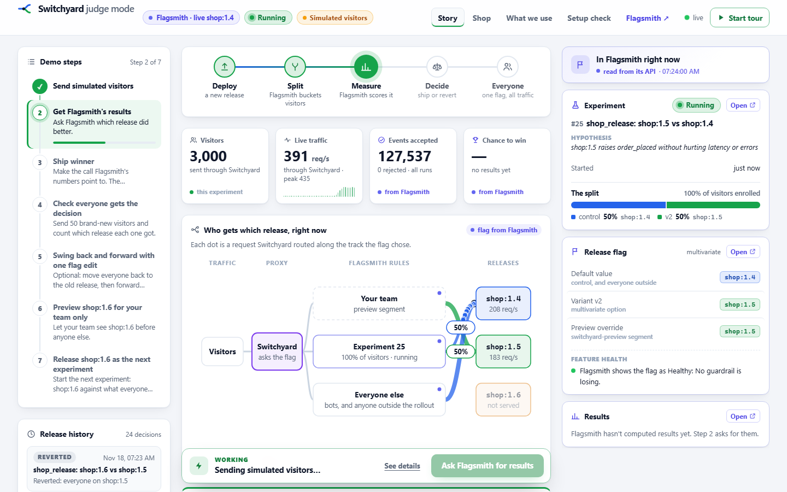
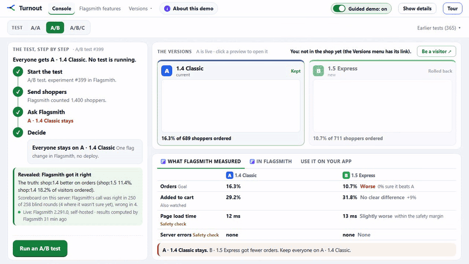
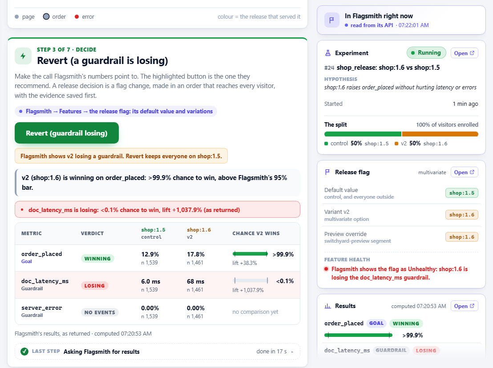
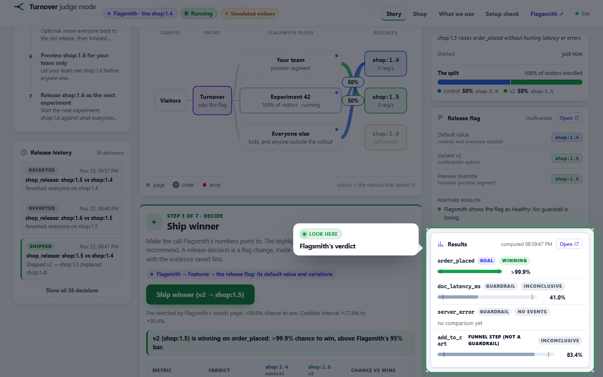
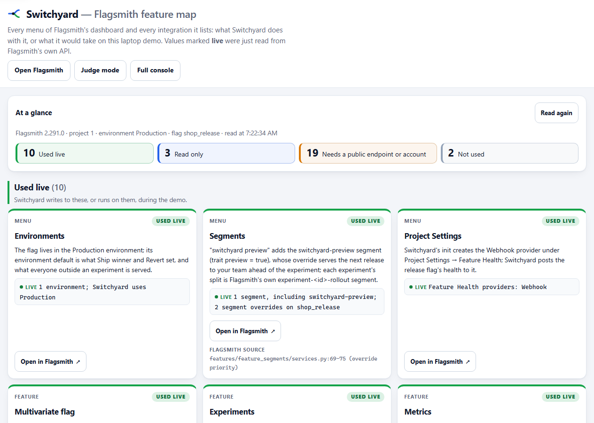

# How Turnout works

The detail behind the [README](../README.md): every mechanism and the security model. What was measured, and how: [spikes/RESULTS.md](../spikes/RESULTS.md).

## Set it up by hand

What `turnout compare` does, step by step, for your own Flagsmith or anything `compare` doesn't cover. Every flag and what to check: [docs/PLUG_AND_PLAY.md](PLUG_AND_PLAY.md).

```sh
# 1. Four questions (Flagsmith: bundled or yours; the releases; success, e.g. "POST /signup 2xx", "header signup" or "none"; % of traffic)
docker build -t turnout:local path/to/turnout   # once, from a Turnout checkout
docker run --rm -it -v "$PWD:/work" turnout:local new --dir /work
# 2. Set up Flagsmith: the release flag, metrics, the experiment (yours: add --project <name|id> --environment <name|key>)
docker compose -f turnout.compose.yml run --rm cli init
# 3. Start the proxy (your app on :8080) and the console (:8090)
docker compose -f turnout.compose.yml up -d
```

`new` writes `turnout.config.yml`, `turnout.compose.yml` (the proxy, the console and the CLI, plus your release images if you gave images) and, for a bundled Flagsmith, `flagsmith.compose.yml`. Every answer is also a flag, for scripts: `new --yes --release v1=http://host.docker.internal:3000 --release v2=http://host.docker.internal:3001 --success "POST /signup 2xx" --traffic 50`. With your own Flagsmith, `init --project` reuses your project and environment and creates nothing else; it never touches other flags ([docs/SETUP.md](SETUP.md#bring-your-own-flagsmith)). The image is `turnout:local`, built from a Turnout checkout (the `turnout` command builds it for you).

A second, different example lives in [`examples/landing/`](../examples/landing/README.md): a static landing page with a Sign up button, two releases as two containers, success = `POST /signup` 2xx.

### Will it work with my app?

- **Success is a web request.** For example "`POST /checkout` returned 2xx" or "`GET /thank-you` loaded". A click that only changes the page in the browser can't be measured, unless the app names the event in a response header (below).
- **Both versions work with the same data.** They share the database, so schema changes must stay backward compatible.
- **No hard-coded hostnames.** Use relative links (`/cart`, not `http://app-v2:3000/cart`) so visitors stay behind Turnout. Turnout already rewrites a redirect's `Location` header that points at the release's own address to a relative path; links inside pages, scripts and API responses are not rewritten. If the app must print absolute links, serve its public host name through Turnout so those links come back to the proxy.
- **Give the `https://` URL for a release served over https.** Turnout calls each release at the address you gave it.
- **Test with a browser, not `curl`.** Turnout treats `curl` and other non-browser user agents as bots: they are served but never counted. Use a browser, or send a browser `User-Agent`.
- **Running next to another Turnout?** `turnout new --proxy-port <port> --console-port <port>` publishes the proxy and the console on free ports; `init` prints the judge link with that console port.
- **No cookies named `tn_id` or `tn_preview`.** Those are Turnout's: `tn_id` keeps each visitor on the same version. The proxy removes those two from the request before it reaches your app; your app's own cookies pass through both ways untouched.
- **A visitor counts from their first page load.** The first page a browser loads is routed by the flag, records the exposure and sends the guardrails, and its response sets `tn_id`, so a visitor who leaves after one page (a bounce) is in the data. Without the cookie, only a browser's page load counts: API calls, assets and cookie-less scripts never become identities.
- **Single-page apps:** after the first load, navigation happens in the browser and Turnout sees no new page loads. The exposure is still right (it's the first load), but set the goal on an API call (`POST /api/signup` returned 2xx) or the `X-Turnout-Event` header, not on a page URL; `doc_latency_ms` covers full page loads only. The automated plug-and-play test covers a client-routed app with a JSON API ([`test/plug-and-play.test.ts`](../test/plug-and-play.test.ts)).

#### Optional: name the event in a response header (still no SDK)

When success isn't a fixed request, the app can say so itself. Set `header: true` on the goal:

```yaml
goal:
  event: signup
  header: true          # with or instead of `when:`
```

and answer the converting request with `X-Turnout-Event: signup`. Several events are comma-separated, and each may carry a number for sum or mean metrics: `X-Turnout-Event: signup, plan_chosen;value=49`. Turnout sends each as a Flagsmith event for that visitor on the same terms as the `when:` goal (counted visitors only, from their first page load; never for bots or when Flagsmith couldn't answer), ignores invalid names and guardrail names, takes at most 5 per response, and removes the header from every response, with or without `header: true`, so visitors never see it. `init` creates the metric for `goal.event`; other event names reach Flagsmith but need a metric there to be measured. If a request both matches `when:` and names `goal.event`, it counts once. `turnout new --success "header signup"` writes this goal.

## Why it can't make the four wiring mistakes

Hand-wiring an experiment into an app commonly goes wrong in four ways. Turnout's design rules each one out:

| Mistake | Why it can't happen here |
|---|---|
| Unstable identifier | Every visitor gets one random first-party ID cookie, kept for a year, and that ID is the Flagsmith identity ([`src/proxy/server.ts:119-129`](../src/proxy/server.ts), [`:202`](../src/proxy/server.ts)) |
| Exposures recorded on one side only | The proxy routes the request from the same evaluation that records the exposure, so every arm records them the same way ([`src/proxy/server.ts:141-150`](../src/proxy/server.ts)) |
| Exposures rising while conversions stay flat | Conversions come from the real HTTP response (`POST /checkout` returning 2xx) under the same ID ([`src/proxy/server.ts:166-171`](../src/proxy/server.ts)) |
| A boolean flag converted to multivariate late | `init` creates the release flag with a release label as its value and adds the `v2` variant in the same run, before any experiment ([`src/commands/init.ts:130-135`](../src/commands/init.ts), [`:176-185`](../src/commands/init.ts)) |

Decisions read Flagsmith's own credible interval: when it crosses zero, Turnout recommends **Keep running** rather than a ship. `turnout release --aa` runs an A/A test (the same release on both sides), and `turnout check` is an Experiment Doctor for any Flagsmith team, proxy or not.



Turnout runs as an overlay on Flagsmith's official self-hosted Docker Compose. Built for Toggle Wars, the Flagsmith Experimentation hackathon, Track 03: Build on Open Source Flagsmith. Licence: BSD-3-Clause.

## The problem

1. **A release isn't an experiment.** A Flagsmith experiment is app code: Flagsmith's PayPal-button example has three touchpoints in the app (`useExperiment`, `trackEvent` and an anonymous ID; [`example-paypal-button.md:56,61,76`](https://github.com/Flagsmith/flagsmith/blob/main/docs/docs/experimentation/example-paypal-button.md)). When the change is the whole deploy, v1.4 against v1.5, there's no single line to wrap in a flag.
2. **Ending an experiment has a sharp edge.** The docs say to end the experiment, then update the flag ([`analyse-an-experiment.md:58-61`](https://github.com/Flagsmith/flagsmith/blob/main/docs/docs/experimentation/analyse-an-experiment.md)). On the pinned image, the experiment's split stays in place after it's completed until the flag's next experiment starts, so that edit reaches none of the identities the rollout covered. **Ship winner** drains the split first, so it reaches all of them (the measured run: [spikes/RESULTS.md](../spikes/RESULTS.md)). Details and sources: [docs/FLAGSMITH.md](FLAGSMITH.md#ending-an-experiment-what-the-docs-say-and-what-the-pinned-image-does).

## What Turnout does

| Round | Flagsmith does | Turnout does |
|---|---|---|
| 01 Multivariate flag | `shop_release` has variants `control` and `v2`; each variant's **value** is the release it serves (`shop:1.5`) | Routes each visitor to the container for that release, from an allowlist |
| 02 Metrics | Holds the goal and the guardrails | Turns HTTP into events: "POST /checkout returned 2xx" becomes `order_placed` (the goal), "POST /cart/add" becomes `add_to_cart` (a secondary funnel metric, never a guardrail); every page load gives `doc_latency_ms` and `server_error`; with the `lcp_ms` and `cls` guardrails, the visitor's own browser reports page speed too (below) |
| 03 Split traffic | Buckets visitors, records exposures, computes the Bayesian result | Records an exposure when a returning visitor loads a page |
| 04 Ship the winner | Serves the winner from the same flag | Warns when the winner is losing a guardrail; ships in an order that reaches everyone; writes the decision to the release |

**The demo, in order** (simulated visitors, labelled as such):
1. `shop:1.5` (one-page checkout: cart, shipping and payment on one page) against `shop:1.4` ("Step 1 of 3" checkout). Simulated visitors add to cart at the same rate on both; 1.5 wins at checkout completion, so `add_to_cart` stays level while `order_placed` rises. Preview browsers and debug requests see a "Release 1.5" footer badge (the proxy sends the app an `X-Turnout-Release` request header for them only, and strips any copy a visitor sends); ordinary visitors never see it. `grep -ri flagsmith` over the shop image finds nothing, yet Flagsmith's results page shows v2 ahead. **Ship winner**: the traffic map's two tracks merge.
2. One edit to the flag's default swings everyone back, made in Flagsmith's flag editor or with the console's **Swing back** button; the console notices that the flag changed after the ship.
3. `turnout preview shop:1.6`: only your team's browsers see it. `turnout release shop:1.6` starts the next experiment on the same flag.
4. `shop:1.6` carries a **deliberate test fault**: a labelled 60 ms delay on every page (`SEEDED_DELAY_MS`), there to show a guardrail catching a release that wins on orders. It wins on orders, but Flagsmith shows it losing on `doc_latency_ms`; the Ship dialog says so in red and asks you to accept that. You **Revert** instead, and the release notes record why.



## How it works

```text
             ┌──────────────────────── Turnout ────────────────────────┐
 visitor ───▶│ cookie identity → Flagsmith flag (local evaluation)        │───▶ shop:1.5  (control: live release)
             │ HTTP rules → exposures, conversions, guardrail events      │───▶ shop:1.6  (v2: new release)
             └────────────────────────────┬───────────────────────────────┘
                                          │ events (server key)
                                          ▼
                               self-hosted Flagsmith
                      flag · rollout · metrics · Bayesian results
```

1. **Identity and routing.** One random first-party ID cookie per visitor (no names, emails or IPs). The Node SDK evaluates the flag locally, so routing adds no network call. The flag's value names a release; only releases in `turnout.config.yml` are reachable.
2. **When Flagsmith can't answer** (not loaded yet, slower than 150 ms, flag off, a value not in the allowlist) a visitor gets the **live release**: what visitors outside the experiment are served, remembered across restarts. Bots get it too, and are never counted.
3. **Events.** A visitor counts from their first page load in a browser (bounces included); API calls, assets and cookie-less scripts without the cookie never become identities. A page load records the exposure; rules turn responses into conversions; page loads send the guardrails. All server-side; no client key is published.
4. **Scoring.** Flagsmith alone computes lift, credible interval and chance to win. Turnout shows its numbers as returned.

### Page speed in real browsers

`doc_latency_ms` is the time to the app's response headers, measured by the proxy: it catches a slow server, not a slow page. Add `lcp_ms` and `cls` to `guardrails:` and the proxy appends one small script to every uncompressed HTML page it serves to a counted visitor. In the visitor's browser it reads two numbers with the browser's own `PerformanceObserver`: **largest contentful paint** (when the page's main content appeared, in ms) and **cumulative layout shift** (how much the page jumped while loading; shifts right after a click or key press don't count). When the visitor leaves or hides the page it sends them once to `/__turnout/vitals`, and the proxy records them as that visitor's Flagsmith events, so Flagsmith scores them per version like any other guardrail. No app code, no client key, no names or values from the page; reports from anyone the proxy didn't serve, and numbers out of range, are dropped.

- A harm worth acting on is 100 ms of LCP or 0.02 of CLS (and over 5% relative), the same rule as the 20 ms page-speed floor.
- **Only when both versions reported about as often.** Flagsmith averages a Mean metric over every exposed visitor, counting a visitor with no event as 0. So a version whose visitors report less often (they left before the page finished, or the script was blocked) reads faster than it is: a slower release that loses more visitors early would look better. The proxy therefore also records `vitals_reported` for each visitor whose browser reported, shown next to the results as each version's reporting rate, and `lcp_ms` and `cls` count only when the two rates are within 5 percentage points; otherwise the recommendation says they weren't compared, and why.
- A compressed page (`Content-Encoding: gzip`) passes through untouched, so it isn't measured in the browser.
- A new experiment takes its metrics from `turnout.config.yml` in the guided demo, or with `turnout release --config-metrics`; otherwise it copies the previous experiment's.

The whole integration is one file, [`turnout.config.yml`](../turnout.config.yml): the flag, the allowlist of releases and their containers, the goal as an HTTP rule (`POST /checkout` returning 2xx) and the guardrails.

### Ship winner and Revert

The winner is pre-selected by the results page's own rule ([how Turnout reads it](FLAGSMITH.md#the-results-pages-winner-as-turnout-reads-it)) and confirmed by a person. If Flagsmith shows it losing a guardrail (under 5% chance to win, and a harm worth acting on: more than 5% relative and, for page speed, at least 20 ms), the console and CLI say so in red and need an explicit "ship anyway".

**Why 5% to warn but 1% to revert:** a warning only asks a person to look, so it can fire early; the guard acts on its own with nobody checking, so it waits until Flagsmith is nearly certain (1% or less, with at least 100 identities) before it reverts.

| Step | What Turnout does | Why |
|---|---|---|
| 1 | Pause the experiment | No new exposures while traffic moves |
| 2 | Save a decision snapshot of Flagsmith's results | The evidence, kept before anything moves; its path goes into the release notes |
| 3 | Set the flag's environment default to the winner, enabled | Everyone outside the experiment gets the winner; the default keeps the value control served, so control stays the same release |
| 4 | Set the rollout to 0%, with the winner's weights | Drains the experiment's cohort onto the default |
| 5 | Complete the experiment | Results are final; the flag is an ordinary flag again |

Each step shows its API call first, is read back from Flagsmith afterwards (the sequence stops if the change doesn't show), is safe to re-run, and is recorded in Turnout's release ledger. **Revert** is the same sequence with control as the winner, so it leaves no split behind either. Rolling back after a ship is an ordinary flag edit.

### Guarded releases, shown in Flagsmith's own dashboard

While an experiment runs, the console reports the release flag's health to **Flagsmith's Feature Health** (its generic Webhook provider, which `init` sets up). When the new release loses a guardrail, Flagsmith tags the flag **Unhealthy** in its own dashboard, with Flagsmith's numbers as the reason, for example "83 on shop:1.6 vs 15 on control; chance to win 0.0%" (means per exposed identity; an identity with no event counts as 0). The tag clears when the experiment ends.

**The guard** is opt-in (`TURNOUT_GUARD=revert`, or the switch in guided demo). It asks Flagsmith for fresh results every 5 minutes, Flagsmith's own limit, and reverts when a guardrail's chance to win drops to 1% or below with at least 100 identities. **It never ships on its own.** The ledger says who decided: "Reverted to control (shop:1.5) automatically by Turnout's guard".



### Releases on one flag

| Stage | Command | Flagsmith feature |
|---|---|---|
| **Preview** | `turnout preview shop:1.6` | A segment override (`turnout-preview`: trait `preview = true`) serves the new release to browsers that opened the preview link. It ranks above the experiment's rollout, so your team stays out of the experiment's data |
| **Experiment** | `turnout release shop:1.6 --hypothesis "…"` | What the flag serves today becomes `control`, the new release `v2`; the next experiment starts with the hypothesis in Flagsmith's required field |
| **Decision** | Ship winner or Revert | The environment default, as above |

**The release ledger.** Each decision is appended to `.turnout/ledger.jsonl` and rendered into `.turnout/RELEASES.md`: the experiment, the hypothesis, Flagsmith's results as returned, the decision, any guardrail you accepted and the decision snapshot's path. With `GITHUB_TOKEN` and `GITHUB_REPOSITORY` set, the same section goes into the GitHub Release for the release's tag (`shop:1.6` → `v1.6`). Flagsmith also writes each change to its audit log, but a free self-hosted plan shows 0 days of it, so the ledger is the record you can read.

## Running it by hand

The start script also takes `demo`, `status`, `stop` and `reset` (`reset --yes`, or `reset /yes` on Windows, wipes without asking). Plain `docker compose` works in any shell too:

```bash
cp .env.example .env
docker compose up -d --wait flagsmith   # Flagsmith on 127.0.0.1:8000, once healthy
docker compose run --rm cli init        # bootstraps Flagsmith, writes keys to .env
docker compose up -d --build            # proxy :8080, console :8090, three shop releases
docker compose run --rm cli doctor      # is everything in place?
```

Links use `127.0.0.1` rather than `localhost`: on Windows, a browser that tries `localhost`'s IPv6 address first waits for that attempt to fail. In Codespaces, [`.devcontainer/start.sh`](../.devcontainer/start.sh) runs these steps and adds the forwarded `*.app.github.dev` hostnames to `.env`. More in [docs/SETUP.md](SETUP.md): what the scripts check and install, guided demo on a phone or another computer, Linux user ids, ports and networks, and using an existing Flagsmith instance.

## Guided demo

<http://127.0.0.1:8090/judge> runs a whole test from one desktop screen. Pick the kind of test (A/A, A/B or A/B/C), then follow the four steps (start the test, send shoppers, ask Flagsmith, decide), one green button at a time, or press **Play it for me**. The right side shows a live preview of each version and Flagsmith's results, a column per version with Flagsmith's call against A. A ten-stop tour (under two minutes) opens on the first visit. Flagsmith's dashboard refuses to be framed, so the Flagsmith menu opens it in a separate tab, with the login.

Each shop release has its own look, so you can tell at a glance which one served you: 1.4 **Classic** (blue, multi-step checkout), 1.5 **Express** (green, one-page checkout) and 1.6 **Bold** (charcoal and orange, with the deliberate 60 ms test fault that trips the page-speed guardrail). The full console at <http://127.0.0.1:8090/> adds the traffic map, a choice of how many visitors to send, and the swing back after a ship. Details: [docs/JUDGE_MODE.md](JUDGE_MODE.md).



## `check` and `ship` on any Flagsmith experiment

These work without the proxy, on experiments your app runs through the SDK. `check` is read-only: it reads the environment document and exits 1 when an experiment's split is still on a flag whose experiment isn't running. With only a server key it can't tell a paused experiment from a completed one, so both fail; with an admin key it reads each experiment's status. It is also a **reusable GitHub Action** (`action.yml`):

```yaml
- uses: actions/checkout@v5
- uses: tharunkumardeveloper/turnout@v1
  with:
    api-url: https://flagsmith.example.com/api/v1/
    server-key: ${{ secrets.FLAGSMITH_SERVER_KEY }}
    admin-key: ${{ secrets.FLAGSMITH_ADMIN_KEY }}   # optional: tells paused experiments from completed ones; submits Code References
    project-id: 1                                     # with admin-key
```

`ship "<experiment link>"` takes the link Flagsmith's experiment page ends on (`…/environment/<key>/experiments/<id>`), prints the results and the plan, and waits for you. Every command and option: [docs/CLI.md](CLI.md).

## Security model

- **Keys are split by container.** The public proxy gets only the server key and the preview token. The admin key lives in the console and the one-off CLI. The console also holds Flagsmith's admin login for guided demo's sign-in step, which shows the password only on this machine.
- **Networks are split too.** The proxy shares a network with Flagsmith's API (flag reads and events), one with the console (the traffic feed) and one with the shops, but can't reach Postgres or the console's admin traffic. The shops reach only the proxy.
- **The proxy can only reach allowlisted releases.** It accepts only `/path` request targets (`//host/…`, absolute URLs and backslashes get a 400), builds every upstream URL from the allowlist, and answers WebSocket upgrades with a 501.
- **The console** is published on `127.0.0.1:8090` only, accepts only loopback Host headers (against DNS rebinding), needs a per-boot token on every API call, and refuses an action if the experiment changed since the page loaded. Other devices use a second port, `8091`, where every request needs the judge cookie whatever Host header it sends, and the admin password is never sent. The judge link that sets the cookie carries `TURNOUT_JUDGE_TOKEN`; rotate the token to revoke it.
- **Flagsmith's own port** stays on `127.0.0.1` even when Turnout's are published to your network: the official compose file's placeholder secrets are kept.
- **The preview cookie** holds an HMAC of the preview token, not the token. Rotate `TURNOUT_PREVIEW_TOKEN` to revoke every preview browser.
- **Responses are per visitor**, so Turnout sets `Cache-Control: private` and `Vary: Cookie`, and strips its own cookies before anything reaches the app.

### Try it with your app: what it can do on your machine

Try it builds or pulls the versions you give it and runs them as containers, through the Docker socket. **The Docker socket is root on the machine**, so pasting a repository is the same as running `docker build` and `docker run` on it yourself: its Dockerfile and its code run on your computer. Paste only repositories you would run anyway.

- **Local only.** The `tryit` service exists only in local mode; server mode turns it off (`profiles: [never]` in `compose.server.yml`), so the live demo can never build or run anything someone pastes. Its API is reached only through the console on `127.0.0.1`, and the versions are published on `127.0.0.1` only.
- **The containers it starts** are not privileged, mount nothing from your machine, sit on their own Docker network and are capped at 768 MB of memory each. They can reach your machine's ports through `host.docker.internal`, as any container can, so an app can call a database you run on the host.
- **The `tryit` service itself** runs as root inside its container, because the socket belongs to root; it is the only Turnout container with the socket.
- **To remove what it started:** its containers and networks carry the label `turnout.tryit=1`; `docker rm -f $(docker ps -aq --filter label=turnout.tryit=1)` and `docker network prune --filter label=turnout.tryit=1` remove them (images it built stay until `docker image prune`).

## Measurements

Every measurement, how it was run and its numbers: [spikes/RESULTS.md](../spikes/RESULTS.md). The blind rounds that grade Flagsmith's calls: [docs/BLIND_ROUNDS.md](BLIND_ROUNDS.md).

**Not claimed:** production users, prevented incidents, or any simulated or seeded number as evidence about real users.

## How Flagsmith is used

Without Flagsmith, Turnout can't route, enrol, measure, score, ship or keep its release history. It uses a multivariate flag whose variant values are release labels; experiments, their rollout and lifecycle API; local evaluation with `getExperimentFlag` and `trackEvent`; the events endpoint's per-event answers; metrics with directions; the Bayesian results and the results page's winner rule; the environment document; segments and override priority; Feature Health; a permanent tag, which puts the flag under the **Permanent** lifecycle stage; **Code References** (`init`, `turnout code-refs` and the Action submit where the flag's name appears; in this repository that is only `turnout.config.yml`, never the app); Flag Analytics; Prometheus metrics; the sign-up and Admin APIs; and the official Docker Compose. Each one, with file and line: [docs/FLAGSMITH.md](FLAGSMITH.md). The console's `/flagsmith` page lists every Flagsmith menu and integration with what Turnout does with it.



## Prior art

| Tool | How Turnout differs |
|---|---|
| LaunchDarkly Guarded Rollouts (Enterprise add-on) | Open source on self-hosted Flagsmith; Flagsmith's Bayesian result; the guard reverts automatically but never ships; the health shows on the flag in Flagsmith; the result lands in the release |
| GrowthBook URL Redirects; VWO and Optimizely split-URL tests | No redirect and no snippet; Flagsmith's flag, metrics and engine |
| Vercel Rolling Releases, Netlify Split Testing | Any host you run; a product goal and guardrails scored by Flagsmith |
| Flagger, Argo Rollouts, Kayenta | No Kubernetes or Spinnaker; product metrics, not only ops metrics; shipped on one flag |
| SiteSpect (commercial tagless A/B proxy) | BSD-3; router, metrics, result and ship are one Flagsmith flag |

Turnout never redirects: Flagsmith's docs list "redirects that bypass bucketing" among causes of sample-ratio mismatch (`statistics.md:107`).
