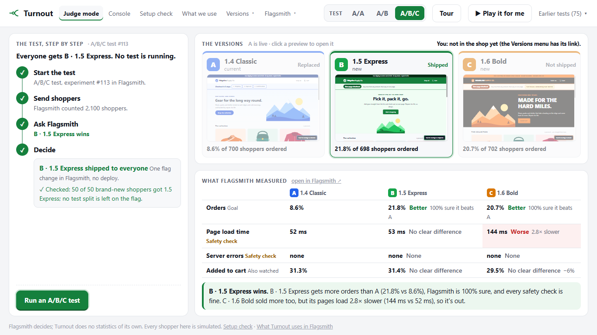

# Judge mode and the console

The console runs at <http://127.0.0.1:8090>. It has four pages:

| Page | What it is for |
|---|---|
| `/judge` | Judge mode: the whole story from a browser, with a guided tour |
| `/` | The full console: traffic map, Flagsmith's results, Ship winner and Revert, demo controls, snapshots, the guard |
| `/flagsmith` | Every Flagsmith menu and integration, what Turnout does with it, a live value from the Admin API, and for anything a laptop demo can't reach, the source behind that |
| `/setup` | The setup check (`doctor`) in the browser |

Every number about results comes from Flagsmith as returned; the console computes no statistics. Every visitor it sends is simulated, and the page says so.

## Judge mode

One desktop screen, no scrolling (checked at 1366×768 and 1920×1080). Every number on it is Flagsmith's, read from its API; every shopper is simulated, and the page says so.

### The page

- **Top bar.** The menu (Judge mode, Console, Setup check, What we use, **Versions**, **Flagsmith**), the kind of test, **Tour**, **Play it for me** and **Earlier tests**.
- **The kind of test.** A/A (the same version on both sides: Flagsmith should find no difference, a check that the split and the counting are fair), A/B, or A/B/C (two new versions at once, each against A). Clicking one starts it; a running test stops first and everyone goes back to A.
- **Left: the test in four steps.** Start the test, Send shoppers, Ask Flagsmith, Decide. Only the current step has a button (one green button at a time), each finished step keeps a one-line result, and a running step shows its progress.
- **Right, top: the versions.** A live preview of each version in the test (A is what everyone gets now), its share of shoppers, and once Flagsmith has counted, its order rate. Clicking a preview opens that version on its own, never counted. The line above says which version this browser gets.
- **Right, bottom: what Flagsmith measured.** A row per metric (orders as the goal, page load time and server errors as safety checks, added to cart as a funnel step), a column per version, and Flagsmith's call for each new version against A. The verdict underneath says what to do in one sentence. A safety check Flagsmith calls slightly worse but within Turnout's margin (more than 5% worse and, for page speed, at least 20 ms) is shown as such, not as a failure.
- **After a decision.** The Decide step shows what changed in Flagsmith, before → after, and then a check that 50 brand-new shoppers all get the result with no test split left on the flag.

**Play it for me** clicks each green button through one whole test, in about a minute for an A/B/C test. The **Tour** (ten stops, under two minutes) opens on the first visit and from the Tour button; it points at each part of the page and says what it is.

### The demo shop

Three releases with their own look: 1.4 **Classic** (blue, a 3-step checkout), 1.5 **Express** (green, a one-page checkout) and 1.6 **Bold** (charcoal and orange, with a labelled 60 ms test fault on every page). The simulated shoppers order at 10%, 20% and 22% (`TURNOUT_DEMO_RATES`; inputs, not evidence), so with 700 shoppers per version Flagsmith decides on its first look: B ships, and C, which sells a little more, is stopped by its slower pages.

### Flagsmith's own dashboard

The **Flagsmith** menu has its address and the admin login, so you can see the same flag, experiment and results there. Flagsmith's dashboard refuses to be shown in a frame, so it opens in a separate tab. The password appears only on this machine's console (port 8090, published on `127.0.0.1` only), never on the port other devices use (8091) or on the public page.

### The public page (server mode)

The same page, read-only, at `https://<host>/judge`: no buttons, no console, no Flagsmith links or login. The autopilot runs the story by itself (A/B: 1.5 against 1.4, then 1.6 against the shipped 1.5, then it starts over), and the current step says what it does next. It rests while nobody has the page open and carries on when someone does.

To open judge mode on another device, see [SETUP.md](SETUP.md#judge-mode-on-another-device).

## The full console

- **Traffic map:** each routed request as a dot, counters for the last 60 seconds, and sidings for past experiments on the flag with their decisions.
- **Decide:** Ship winner and Revert. The plan dialog lists the five steps with the API call each one makes. If the winner is losing a guardrail, it says so in red, and the confirm button waits until you tick the box to ship anyway.
- **Demo controls:** send 50 to 3,000 simulated visitors (1,500 by default), and after a ship, **Swing back** to the release it replaced or **Swing forward** again. Each is one edit to the flag's environment default, the same edit as in Flagsmith's flag editor. A progress bar follows the job; Ship and Revert wait while it runs. The card also follows steps started from judge mode.
- **Flagsmith's results:** the goal and each guardrail, as returned. Mean metrics are labelled "mean per exposed identity": Flagsmith averages over every exposed identity, and one with no event counts as 0 ([details](FLAGSMITH.md#things-we-found-on-the-pinned-image)).
- **Decision snapshots:** the results saved before each decision, newest first.
- **Health and guard:** what was last reported to Flagsmith's Feature Health, and the guard's switch.

When the flag is changed in Flagsmith after a ship, the console says so: it shows the release the flag serves next to the one the ledger recorded.
