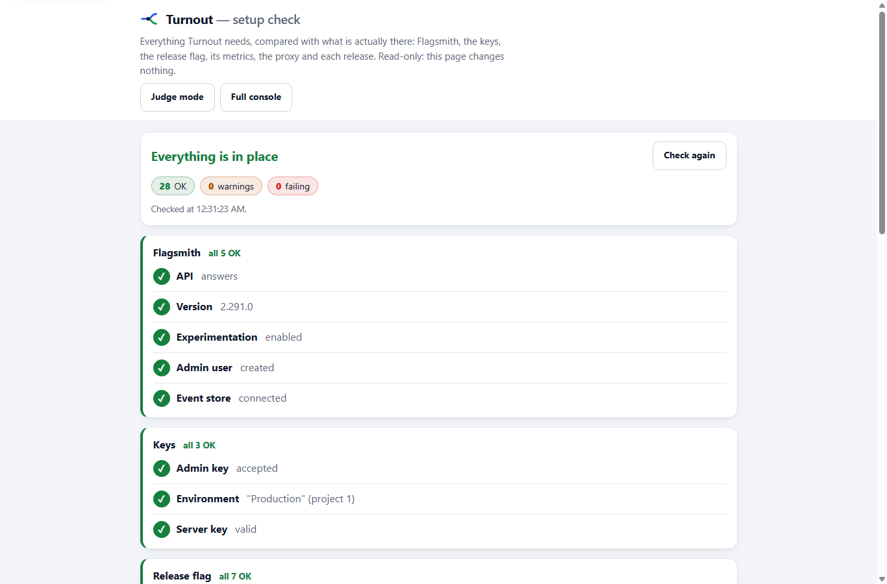

# Setting up Turnout

The [README](../README.md#quick-start) has the short version. This page has the details: what the scripts do, the commands they run, judge mode on another device, Linux user ids, and what runs where.

## What you need

- Docker with Compose 2.20 or later (Docker Desktop on Windows and macOS, Docker Engine on Linux), with about 8 GB of RAM for Docker.
- Free ports 8000 (Flagsmith), 8080 (the proxy and the shop), 8090 (the console and judge mode) and 8091 (judge mode for other devices).
- For development only: Node.js 24 or later, npm and Git.

## The scripts

| Script | What it does |
|---|---|
| `setup.bat`, `setup.sh` | Checks Docker (and starts it), Compose 2.20+, memory, the three ports and `.env`, and for development Node.js 24+, npm and Git; on Windows also WSL 2. Offers to install anything missing: `winget` on Windows, Homebrew on macOS; on Linux it prints the `apt`/`dnf` or Docker install command and asks before running it with `sudo`. On Linux it also writes your user and group id to `.env` (see [Linux](#linux-user-ids)). `/check` (`--check`) changes nothing; `/yes` (`--yes`) installs without asking |
| `turnout.bat`, `turnout.sh` | Starts Flagsmith, sets it up on the first run, starts Turnout, the console and the shop, runs `doctor`, and opens judge mode (`TURNOUT_NO_BROWSER=1` skips the browser) |

`turnout.bat` and `sh turnout.sh` take one action:

| Action | What it does |
|---|---|
| (none) or `start` | Start everything, check the setup and open judge mode |
| `demo` | The same, then send 1,500 simulated visitors through the proxy |
| `status` | Show what's running, run `doctor`, and print the links |
| `stop` | Stop every container; Flagsmith's data and the keys are kept |
| `reset` | Wipe Flagsmith's data, the ledger and the keys, then start from scratch. It asks first; `reset --yes` (`turnout.bat reset /yes`) doesn't |

An unknown action or option stops the script with "Not started." before Docker is touched.

## By hand, in any shell

`compose.yaml` includes Flagsmith's official compose file (`compose.flagsmith.yml`) and the Turnout overlay (`compose.turnout.yml`), so plain `docker compose` works in PowerShell, cmd and any POSIX shell:

```bash
cp .env.example .env
docker compose up -d --wait flagsmith          # Flagsmith on 127.0.0.1:8000, once healthy
docker compose run --rm cli init               # admin, keys, tagged flag, metrics, experiment → .env
docker compose up -d --build                   # proxy :8080, console :8090, shop 1.4, 1.5 and 1.6
docker compose run --rm cli doctor             # is everything in place?
docker compose run --rm cli demo               # labelled simulated visitors
docker compose run --rm cli status --refresh   # Flagsmith's results (one refresh per 5 minutes)
```

To wipe everything: `docker compose --profile tools down -v`, then delete `.turnout/`.

**On a fresh Flagsmith**, `init` creates the first admin itself (`POST /api/v1/auth/users/` with `superuser: true`, which Flagsmith accepts only while no users exist) and saves the login to `.env` straight away. It then connects Flagsmith's own event store, creates the flag (tagged `release`, permanent), the Feature Health provider, the goal and guardrail metrics, and starts the first experiment. Re-running it is safe: it starts the first experiment only when the flag has none.

**On an existing Flagsmith instance**, put an Organisation API key in `.env` as `TURNOUT_ADMIN_KEY` before running `init`.

`compose.flagsmith.yml` is Flagsmith's official `docker-compose.yml` with five edits, each listed in its header: the image tag is pinned to `2.291.0`, the API is published on `127.0.0.1` only (whatever `TURNOUT_PUBLISH_HOST` says), the task processor's port isn't published, the API also joins the `sdk` network, and it keeps idle connections open for 5 s (`GUNICORN_KEEP_ALIVE`; Flagsmith's default is 2, Node's client keeps them for 4).

## Checking the setup

`doctor` compares what Turnout needs with what is there: Flagsmith and its version, the keys, the flag and its variants, the metrics, the experiment and its audience, the proxy, each shop release, Flagsmith's event counter, and whether `.turnout/` and `.env` are writable. Each line is ok, a warning or a failure, with **Expected → Actual** where they differ and how to fix it. It exits 1 when something fails.

- `docker compose run --rm cli doctor` runs inside Compose and reads everything.
- <http://127.0.0.1:8090/setup> shows the same checks in the browser. **Check again** runs them fresh. It runs as the console, which doesn't mount `.env`, so it has no `.env` check.
- `node src/cli.ts doctor --api-url http://127.0.0.1:8000/api/v1/` runs from the host (after `npm install`). Flagsmith serves its Prometheus counter on port 9100 inside Compose only, so from the host that line reads "not checked from the host" and counts as ok.

Right after a restart, the proxy can warn once that its last flag refresh timed out while Flagsmith was starting; the next run is clean.



## Addresses: 127.0.0.1, not localhost

Compose publishes every port on `127.0.0.1`, and the links use `127.0.0.1`: on Windows, a client that tries `localhost`'s IPv6 address (`::1`) first waits for that attempt to be refused before it falls back.

Open the console and the shop on the **same hostname**. Judge mode shows the shop in a frame, and browsers drop the shop's `SameSite=Lax` cookies (the cart and the visitor id) in a frame from another site; `localhost` and `127.0.0.1` count as different sites. The start scripts and `init` follow the hostname in `TURNOUT_PUBLIC_SHOP_URL`, so an older `.env` that still uses `localhost` keeps working.

## Judge mode on another device

The console holds the admin key, so by default only this machine can reach it. To let a phone, tablet or another computer on your network open judge mode:

1. In `.env`, set:
   - `TURNOUT_CONSOLE_HOSTS` to this machine's address on the network, for example `192.168.1.20` (a comma-separated list is allowed);
   - `TURNOUT_PUBLISH_HOST=0.0.0.0`;
   - `TURNOUT_PUBLIC_SHOP_URL=http://192.168.1.20:8080`.
   
   `TURNOUT_JUDGE_TOKEN` must be set too; `init` writes it. The console refuses to start with other hosts listed and no judge token.
2. Run `docker compose up -d`.
3. Run `docker compose run --rm cli init` again. It prints `Judge link for other devices: http://<host>:8091/judge?key=…`, and a hint if the publish host or the shop URL doesn't match.
4. Open that link once on each device, **this machine included**, so every browser uses the same hostname as the shop.

Other devices use the console's second port, **8091**. The link carries `TURNOUT_JUDGE_TOKEN` and leaves a cookie that holds an HMAC of it. On port 8091 every request without that cookie is refused (403, or 421 for a host that isn't listed), whatever Host header it sends, and the admin password that the tour shows for Flagsmith's dashboard is never sent there. Port 8090, this machine's console, is published on `127.0.0.1` only. Rotate `TURNOUT_JUDGE_TOKEN` to revoke every judge device.

What this doesn't cover: a container on the console's Compose networks (`default`, `feed`), the proxy included, can reach port 8090 directly and name a loopback Host. That needs code running in one of those containers. The shops sit on `apps` only and can't reach the console.

`TURNOUT_PUBLISH_HOST=0.0.0.0` also publishes the proxy (the shop, port 8080) to your network. Flagsmith's dashboard and API stay on `127.0.0.1`: the official compose file's placeholder secrets are kept, so it isn't put on a shared network. On another device, "see it in Flagsmith" links point at this machine's dashboard and don't open there. The shops allow the console on the listed hosts to frame them; `SHOP_FRAME_ANCESTORS` replaces that list if you need something else.

## Running on a server

One setting, `TURNOUT_MODE` in `.env`, picks the mode: `local` (the default, everything above) or `server`. The experiment logic is the same in both; server mode only changes networking, secrets and start-up.

1. Point a DNS name at the server and open ports 80 and 443.
2. Run `sh turnout.sh server <hostname>` (or `turnout.bat server <hostname>`). It writes `TURNOUT_MODE=server`, `TURNOUT_HOSTNAME` and random Flagsmith and Postgres secrets (only where they are empty) into `.env`, then starts the stack.
3. From then on every script command uses `-f compose.yaml -f compose.server.yml`. By hand, add the same two `-f` flags to every `docker compose` command.

What changes in server mode (`compose.server.yml`, `deploy/Caddyfile`):

- Caddy (pinned image) on ports 80 and 443 gets a certificate for the hostname and redirects HTTP to HTTPS. `TURNOUT_CADDY_TLS=tls internal` uses Caddy's own CA instead (CI, or a trial on `localhost`).
- `https://<hostname>/` goes to the proxy; its cookies are marked `Secure`, and the shop URL is `https://<hostname>`.
- `https://<hostname>/judge` is judge mode, read-only: GET and HEAD only, to a console port that is never published. Every action is refused there, and the setup check and feature map are left out.
- Flagsmith (8000), the console (8090, 8091) and the proxy's own port (8080) are published on `127.0.0.1` only. Reach them with an SSH tunnel: `ssh -L 8000:127.0.0.1:8000 -L 8090:127.0.0.1:8090 you@<hostname>`.
- Every service has `restart: unless-stopped`.
- The console's autopilot runs the judge story by itself, round and round, so the public `/judge` always shows something happening: labelled simulated visitors, Flagsmith's results (at most one refresh per 5 minutes), Turnout's recommendation followed (ship, revert or keep running), verify, preview, the next release, then a reset. It uses the same jobs as the console's buttons, never while another one runs, and steps aside for 10 minutes after any action from the private console. `TURNOUT_AUTOPILOT=off` in `.env` turns it off; `TURNOUT_AUTOPILOT_VISITORS` and `TURNOUT_AUTOPILOT_PAUSE` (seconds between steps) tune it.
- No browser is opened.
- The start refuses to run while a Flagsmith secret, the Postgres password or a Turnout token is a placeholder (`cli server-check`).
- `doctor` adds a "Server mode" section: HTTPS and the certificate, Secure cookies, 8000 and 8090 not public, no placeholder secrets, restart policies. These checks run only in server mode.

Needs Docker Compose 2.24 or later. Back to local: set `TURNOUT_MODE=local` in `.env` and run `docker compose -f compose.yaml -f compose.server.yml down` once.

## Linux user ids

The console and the CLI write `.turnout/` (snapshots and the release ledger) and `.env` through bind mounts, so they run as `TURNOUT_UID:TURNOUT_GID` (default `1000:1000`, the image's `node` user).

- `sh turnout.sh` sets both from `id -u` and `id -g`, and stops with the `chown` command to run if `.turnout/` or `.env` isn't writable.
- `sh setup.sh` writes them to `.env` for anyone who runs `docker compose` directly.
- `doctor` fails the "State folder" or ".env file" check, with the fix, when either isn't writable.

macOS and Windows don't need this.

## Bring your own Flagsmith

Turnout works against any self-hosted Flagsmith that has Experimentation on (`EXPERIMENTATION_ENABLED=true` on the API). You need its API URL and an Organisation API key for the organisation that owns your project.

```sh
docker run --rm -it -v "$PWD:/work" -w /work ghcr.io/tharunkumardeveloper/turnout new \
  --flagsmith https://flagsmith.example.com/api/v1/ --project "Web" --environment Production
# put the Organisation API key in .env as TURNOUT_ADMIN_KEY (or pass --admin-key to new)
docker compose -f turnout.compose.yml run --rm cli init     # reads TURNOUT_PROJECT / TURNOUT_ENVIRONMENT from .env
docker compose -f turnout.compose.yml up -d
```

What `init --project` creates and what it leaves alone: [CLI.md](CLI.md#init---project-bring-your-own-flagsmith). In short, nothing at the organisation, project or environment level, and no other flag is touched; a flag of the same name with values that aren't your releases is refused.

On this repo's own stack: `init --project` with no flag reuses `.env`'s key, so point `TURNOUT_ADMIN_KEY` at the organisation that owns the project. A free-plan organisation holds one project (`MAX_PROJECTS_IN_FREE_PLAN = 1` in Flagsmith's `app/settings/common.py:69`, checked in `projects/permissions.py:31-38` of the pinned image), and the demo's organisation already has one, so a second app goes in its own organisation. That's how the landing example ran (see [spikes/RESULTS.md](../spikes/RESULTS.md)).

The image isn't published yet: until `.github/workflows/publish.yml` has run on a version tag, build it from this checkout (`docker build -t ghcr.io/tharunkumardeveloper/turnout .`).

## Another config on this stack

The proxy, the console and the CLI read `turnout.config.yml` from a mount, never from the image. `TURNOUT_CONFIG_FILE` picks another file, and the releases needn't be the shops: `compose.demo.yml` holds the three shops, and the proxy doesn't depend on them. The landing example: [examples/landing/README.md](../examples/landing/README.md).

## What runs where

| Service | Published port | Networks | Keys it gets |
|---|---|---|---|
| `flagsmith` (API and dashboard) | 8000, always on `127.0.0.1` | default, sdk | |
| `flagsmith-task-processor`, `postgres`, `migrate-db` | none | default | |
| `turnout` (the proxy) | 8080 | sdk, feed, apps | server key, preview token |
| `console` (console and judge mode) | 8090 on `127.0.0.1`; 8091 for other devices | default, feed | admin key and login, server key, preview and judge tokens, Feature Health URL, GitHub token |
| `shop-1-4`, `shop-1-5`, `shop-1-6` (`compose.demo.yml`) | none | apps | none; the shop has no Flagsmith code |
| `cli` (profile `tools`, one-off commands) | none | default, feed | reads the mounted `.env` |

- **default:** Flagsmith, its Postgres, the console and the CLI (the admin side).
- **sdk:** Flagsmith and the proxy: flag reads and events.
- **feed:** the proxy and the console: the traffic feed (internal port 8081) and judge mode's simulated visitors.
- **apps:** the proxy and the shops. The shops can't reach Flagsmith or the console.

So the proxy can't reach Postgres or the console's Flagsmith-admin traffic. The proxy's port and the console's port for other devices are bound to `TURNOUT_PUBLISH_HOST` (default `127.0.0.1`); Flagsmith's and the console's own port 8090 are always bound to `127.0.0.1`.

## Settings

`.env.example` documents every variable the code reads and every `${…}` value Compose uses, in sections: Flagsmith and keys, judge mode and other devices, Feature Health and the guard, the proxy, Linux, CLI-only, and the ones Compose sets for you. A few worth knowing:

- `TURNOUT_GUARD=revert` switches on the guard (see the README); `TURNOUT_GUARD_THRESHOLD` sets its threshold.
- `TURNOUT_SECURE_COOKIES=1` marks the proxy's cookies `Secure`; set it when a TLS proxy serves the shop over HTTPS.
- `TURNOUT_ACCESS_LOG=0` turns off the proxy's one-line-per-request access log.
- `GITHUB_TOKEN` and `GITHUB_REPOSITORY` write each decision into the GitHub Release for its tag.
- `TURNOUT_REPOSITORY_URL` names the repository for Code References when the checkout has no `https` GitHub `origin` remote; without one, `init` skips Code References and says why.
